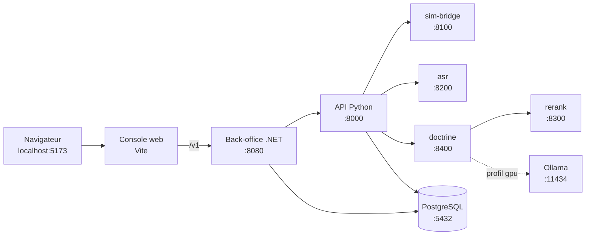
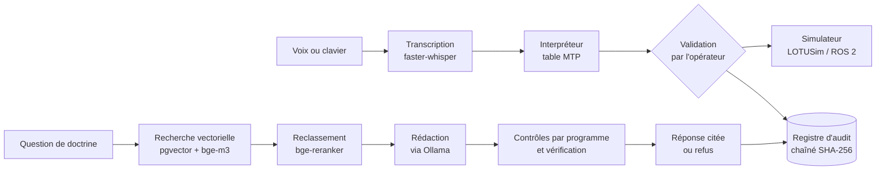

# HANNIBAL X

Système d'aide au commandement naval qui fonctionne entièrement en local : il interprète des messages radio dictés à la voix, montre leur effet sur une formation de navires dans un simulateur, et répond à des questions de doctrine en citant ses sources.

     

> Le nouveau code suit le [plan de réalisation du MVP](docs/plan-realisation-mvp-1.2.0.md) et l'[architecture 1.1.0](docs/architecture-1.1.0.md).
> L'ancien code a été retiré une fois la parité vérifiée (voir [Ancien code](#ancien-code)).

## Sommaire

1. [Ce que fait le système](#ce-que-fait-le-système)
2. [Démarrage en deux minutes : la console seule](#démarrage-en-deux-minutes--la-console-seule)
3. [Tutoriel : lancer tout le système avec Docker Compose](#tutoriel--lancer-tout-le-système-avec-docker-compose)
4. [Serveur du navire (production)](#serveur-du-navire-production)
5. [Architecture](#architecture)
6. [Organisation du dépôt](#organisation-du-dépôt)
7. [Développer](#développer)
8. [Ancien code](#ancien-code)
9. [Résultats mesurés](#résultats-mesurés)
10. [Choix de conception](#choix-de-conception)
11. [Feuille de route](#feuille-de-route)

## Ce que fait le système

| Module | Rôle |
|---|---|
| **Interpréteur de signaux** | Transcrit un message radio (Whisper), le découpe en indicatifs, signaux et chiffres, puis retrouve le sens exact de chaque signal dans la table MTP. Aucune IA dans l'interprétation elle-même. |
| **Console et simulateur** | Tableau de bord, préparation de mission, console de l'opérateur, registre d'audit, vue 3D. Chaque ordre est validé par l'opérateur avant d'être appliqué aux navires du simulateur. |
| **Assistant de doctrine** | Répond en français ou en anglais à une question en langage naturel, cite la publication, l'article et la page, et refuse de répondre quand les documents ne contiennent pas la réponse. |

Principe commun aux trois : **la table et les programmes décident, l'IA explique**. Le modèle de langue n'est jamais réentraîné sur les documents ; il rédige à partir d'extraits retrouvés, sous contrôle automatique.

## Démarrage en deux minutes : la console seule

Pour voir l'interface sans rien installer d'autre que Node.js : un faux back-office tourne dans le navigateur, avec des données inventées.

```bash
corepack enable                       # active pnpm (une seule fois)
pnpm install --frozen-lockfile
pnpm --dir apps/web dev:mock
```

Ouvrir http://localhost:5173 et se connecter avec `instructeur` / `demo` (tous les droits) ou `eleve` / `demo`.

> Le faux back-office garde sa session dans le `localStorage` du navigateur : `/login` renvoie au tableau de bord tant que l'on ne s'est pas déconnecté (menu utilisateur, en haut à droite).

## Tutoriel : lancer tout le système avec Docker Compose

La composition de développement (`infra/compose/compose.dev.yml`) démarre la base, l'API, le back-office et les services de voix, de doctrine et de simulation. La console web tourne à côté, avec Vite, et passe par le back-office.



### 1. Prérequis

| Outil | Version | Pour |
|---|---|---|
| Docker Engine et le plugin Compose | 29 et v2 | tous les services |
| Node.js et pnpm | 24 LTS et 10 | la console web |
| Pilote NVIDIA et `nvidia-container-toolkit` | — | seulement pour le profil `gpu` (Ollama) |

Compter environ 8 Go de mémoire libre sans le profil `gpu`. Le premier `--build` télécharge les images de base et prend plusieurs minutes.

### 2. Préparer le fichier d'environnement

Depuis la racine du dépôt :

```bash
cp infra/compose/dev.env.example infra/compose/dev.env
```

```powershell
Copy-Item infra/compose/dev.env.example infra/compose/dev.env      # Windows
```

Ouvrir `infra/compose/dev.env` et remplacer au moins :

| Variable | Rôle |
|---|---|
| `HX_DEV_DB_PASSWORD` | mot de passe de la base de développement |
| `HX_DEV_ADMIN_PASSWORD` | mot de passe du compte `admin` créé au premier démarrage (tous les droits) |

`dev.env` est ignoré par git : il ne doit jamais être commité.

### 3. Démarrer les services

```bash
docker compose -f infra/compose/compose.dev.yml --env-file infra/compose/dev.env up -d --build
```

Compose démarre PostgreSQL, applique les migrations de l'API et du back-office (`migrate`, `backoffice-migrate`), puis lance les autres services. Suivre le démarrage :

```bash
docker compose -f infra/compose/compose.dev.yml --env-file infra/compose/dev.env ps
```

Les services `migrate` et `backoffice-migrate` doivent finir en `Exited (0)` ; les autres restent `Up` (ou `healthy`).

### 4. Vérifier que tout répond

```bash
curl -s http://127.0.0.1:8000/v1/ready     # API
curl -s http://127.0.0.1:8080/v1/ready     # back-office
```

Sous Windows PowerShell, écrire `curl.exe` (le mot `curl` seul y désigne une autre commande). La documentation interactive de l'API est sur http://127.0.0.1:8000/v1/docs.

### 5. Lancer la console web

```bash
pnpm install --frozen-lockfile
pnpm --dir apps/web dev
```

Vite sert la console sur http://localhost:5173 et transmet les appels `/v1` au back-office (`http://127.0.0.1:8080` ; autre adresse : variable `HX_BACKOFFICE_URL`).

### 6. Se connecter et jouer une mission

1. Ouvrir http://localhost:5173 et se connecter avec `admin` et le mot de passe `HX_DEV_ADMIN_PASSWORD`.
2. Le **tableau de bord** s'affiche (ses chiffres sont encore des données d'illustration).
3. Menu **Missions** : choisir un scénario et son navire, régler les options, puis **Démarrer la mission**.
4. Dans la console, taper un ordre (par exemple `ALL SHIPS CORPEN 045 SPEED 14`), le **Simuler**, le **Soumettre**, puis le **Valider**.
5. **Arrêter la mission** affiche le débriefing ; le **Registre** garde chaque commande.

### 7. Options

Chaque option se règle dans `dev.env`, puis on relance la commande de l'étape 3.

| Besoin | Réglage |
|---|---|
| Vraie reconnaissance vocale (sur processeur) | `HX_ASR_ENGINE=whisper` ; le modèle `HX_ASR_WHISPER_MODEL` est téléchargé au premier démarrage |
| Vrai reclassement des passages | `HX_RERANK_SCORER=cross_encoder` |
| Modèles de langue locaux | ajouter `--profile gpu` à la commande, puis télécharger les modèles (ci-dessous) |
| Vraie doctrine | `HX_DOCTRINE_ADAPTERS=real` et `HX_DOCTRINE_DATABASE_URL`, avec l'index de doctrine chargé ([données hors dépôt](docs/donnees-hors-depot.md)) |

```bash
docker compose -f infra/compose/compose.dev.yml --env-file infra/compose/dev.env --profile gpu up -d
docker compose -f infra/compose/compose.dev.yml --env-file infra/compose/dev.env exec ollama ollama pull gemma3:12b
docker compose -f infra/compose/compose.dev.yml --env-file infra/compose/dev.env exec ollama ollama pull bge-m3
```

Par défaut, sans réglage : la voix renvoie toujours le même ordre (`scripted`), la doctrine répond sur un corpus inventé (`sample`) et le simulateur est cinématique, sans LOTUSim.

### 8. Arrêter, nettoyer, dépanner

| Action | Commande (ajouter `-f infra/compose/compose.dev.yml --env-file infra/compose/dev.env`) |
|---|---|
| Voir les journaux d'un service | `docker compose ... logs -f api` |
| Arrêter en gardant les données | `docker compose ... down` |
| Tout effacer (base, enregistrements, modèles) | `docker compose ... down -v` |
| Reconstruire après un changement de code | `docker compose ... up -d --build` |

| Symptôme | Cause probable |
|---|---|
| `définir HX_DEV_DB_PASSWORD dans dev.env` | `dev.env` absent, ou `--env-file` oublié |
| Port déjà utilisé (5432, 8000, 8080…) | un autre PostgreSQL ou service tourne ; l'arrêter, ou changer `HX_DEV_DB_PORT` pour la base |
| La connexion `admin` est refusée | `HX_DEV_ADMIN_PASSWORD` était vide au premier démarrage : le définir, puis `down -v` et relancer |
| `/login` renvoie directement au tableau de bord | une session est déjà ouverte : se déconnecter depuis le menu utilisateur |
| Le micro ne s'ouvre pas | le navigateur exige `localhost` ou HTTPS ; sinon, importer un WAV |

## Serveur du navire (production)

Le serveur n'a pas Internet : tout arrive par un paquet hors ligne (images, modèles, SBOM). La composition `infra/compose/compose.yml` y ajoute le proxy HTTPS (Caddy, qui sert aussi la console construite), les modèles sur carte graphique, la passerelle ROS 2 vers LOTUSim et l'observabilité (Prometheus, Grafana).

```bash
infra/bundle/build-bundle.sh 1.0.0    # machine reliée à Internet → dist/hannibal-1.0.0/
sudo ./install.sh                     # sur le serveur, depuis le paquet copié
```

Secrets, certificats, table MTP, sauvegardes et surveillance : voir [docs/exploitation.md](docs/exploitation.md) et [infra/compose/secrets.example](infra/compose/secrets.example).

## Architecture



| Service | Rôle | Port en développement |
|---|---|---|
| `web` | Console React (servie par le proxy en production) | 5173 (Vite) |
| `backoffice` | Back-office .NET : comptes, rôles, permissions, seul point d'entrée de la console | 8080 |
| `api` | API Python (FastAPI, architecture hexagonale) : missions, ordres, registre | 8000 |
| `sim-bridge` | Passerelle vers le simulateur (cinématique en développement, ROS 2 en production) | 8100 |
| `asr` | Reconnaissance vocale (faster-whisper) | 8200 |
| `rerank` | Reclassement des passages | 8300 |
| `doctrine` | Assistant de doctrine | 8400 |
| `postgres` | PostgreSQL 17 + pgvector : missions, registre, passages | 5432 |
| `ollama` | Modèles de langue locaux (profil `gpu`) | 11434 |

Tous les ports de développement n'écoutent que sur `127.0.0.1`.

## Organisation du dépôt

```
apps/
  api/                 API Python (FastAPI)
  backoffice/          Back-office .NET
  web/                 Console React (Vite) et vue 3D (three.js)
services/
  asr/  doctrine/  rerank/  sim_bridge/
packages/
  core/                Domaine : scénarios, interpréteur d'ordres
  platform/            Socle commun : configuration, journaux, erreurs, santé, métriques
  contracts/           Modèles d'échange et schémas JSON publiés
infra/
  compose/             Compositions Docker (développement et serveur), modèles d'environnement
  bord/                Proxy Caddy et image de la console
  bundle/              Paquet hors ligne et script d'installation
  backup/  systemd/  observability/
eval/                  Comportement figé (goldens) et recettes
docs/                  Architecture, plan de réalisation, ADR, développement, exploitation
interfaces/            Messages ROS du moteur LOTUSim
```

Les documents de référence, les données qui en sont tirées, les modèles, l'audio et les secrets ne font jamais partie du dépôt ([données hors dépôt](docs/donnees-hors-depot.md)).

## Développer

```bash
uv sync --all-packages        # Python 3.12, dépendances figées par uv.lock
uv run pre-commit install     # contrôles à chaque commit (dépôt local, sans CI distante)
pnpm install
./tools/check.sh              # contrôle complet ; sous Windows : .\tools\check.ps1
```

Lancer chaque service seul, variables, règles du code et de git : [docs/developpement.md](docs/developpement.md). Historique : [CHANGELOG.md](CHANGELOG.md). Décisions : [docs/adr/](docs/adr/README.md).

## Ancien code

La première version (applications v1 à v3, assistant de doctrine v2) a été supprimée du dépôt une fois tout son comportement repris dans `hannibal_core` ([ADR 0002](docs/adr/0002-strangler-fig-legacy.md)). Ses sorties restent la référence : les goldens de `eval/characterization` ont été enregistrés sur elle, et le nouveau code est vérifié contre eux à chaque commit. Pour lire l'ancien code, l'historique git le garde (`git show a490113:legacy/README.md`).

## Résultats mesurés

### Interpréteur de signaux

| Mesure | Résultat |
|---|---|
| Interprétation sur le texte | 1 541 messages justes sur 1 541 |
| Voix radio simulée, Whisper large-v3-turbo avec vocabulaire du domaine | 93,1 % (491 messages) |
| Même mesure sans vocabulaire | 82,9 % |
| Voix radio simulée, Whisper small avec vocabulaire | 95,0 % (160 messages) |

### Assistant de doctrine

Jeu de test de 300 questions et 29 pièges (questions sans réponse dans les documents), jamais utilisé pour régler le système.

| Configuration | Bonne page / autre page / refus à tort | Pièges refusés | Score global | Temps |
|---|---|---|---|---|
| gemma3:12b | 264 / 26 / 10 | 27 / 29 | 93,6 % | 9 s |
| **gemma4:12b + tableaux ligne par ligne** | 272 / 13 / 15 | 29 / 29 | ≈ 94 % | 7 s |
| gemma3:27b (ne tient pas sur 16 Go) | 265 / 28 / 7 | 29 / 29 | ≈ 96 % | 53 s |

Recherche seule : la bonne page est classée première dans 82 % des cas et figure dans les dix premières dans 96 %.

Méthode : un petit jeu pour régler, un grand qui ne sert qu'à mesurer ; verdicts automatiques ; les réponses qui citent une autre page sont relues une à une ; aucun changement n'est gardé sans mesure sur le grand jeu. Les réponses ont été relues par l'équipe de développement ; une relecture par un expert naval reste à faire.

Configuration de référence : Intel Core i5-12400F, 32 Go, NVIDIA RTX 4060 Ti 16 Go, Ubuntu 26.04 LTS, Docker 29. En service, l'ensemble occupe environ 13,6 Go de mémoire vidéo.

## Choix de conception

| Choix | Raison |
|---|---|
| Table de signaux et interpréteur sans IA | Exactitude et référence exacte ; une mise à jour se fait en modifiant la table |
| Recherche documentaire plutôt que réentraînement du modèle | Citations vérifiables, pas de connaissance approximative |
| Seul le modèle de reclassement est entraîné | Améliore la recherche sans toucher au modèle qui rédige |
| Contrôles par programme après la rédaction | Un nombre absent des sources est refusé sans discussion |
| Refuser plutôt que deviner | Une réponse fausse affirmée avec assurance est pire qu'un refus |
| Validation humaine avant application d'un ordre | La transcription de la voix n'est pas fiable à 100 % |
| Tout en local, sans Internet | Les documents de référence ne quittent pas la machine |

## Feuille de route

- Brancher le tableau de bord et les réglages de formation sur de vraies données (aujourd'hui : maquette et aperçu).
- Relecture d'un échantillon de réponses par un expert naval.
- Proposition « vouliez-vous dire … ? » quand un sigle dicté ou tapé est inconnu.
- Jeu de mesure élargi : questions de suivi, croisement de publications, fautes de dictée.
- Simulateur : distance standard, changement de guide, conversion en ligne de front.
- Essais sur de vrais enregistrements radio.

## Crédits

Moteur de simulation : LOTUSim. Modèles 3D des navires : Pippa (Sketchfab), licence CC BY 4.0. Police : Roboto Condensed (SIL Open Font License 1.1).
