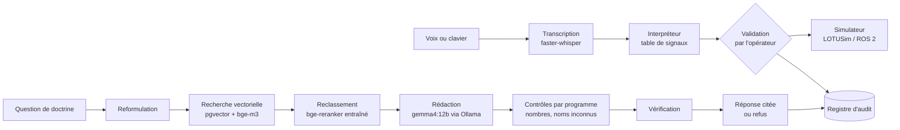

# HANNIBAL X

Système d'aide au commandement naval qui fonctionne entièrement en local : il interprète des messages radio dictés à la voix, montre leur effet sur une formation de navires dans un simulateur, et répond à des questions de doctrine en citant ses sources.

   

> **Refonte en cours (version 0.1.0, Lot 0).** L'ancien code est rangé dans `legacy/` et reste exécutable jusqu'au Lot 6.
> Le nouveau code se construit à côté, lot par lot, selon le [plan de réalisation du MVP](docs/plan-realisation-mvp-1.2.0.md)
> et l'[architecture 1.1.0](docs/architecture-1.1.0.md). Pour travailler sur le nouveau code : [docs/developpement.md](docs/developpement.md).

## Sommaire

- [Refonte : démarrage rapide](#refonte--démarrage-rapide)
- [Ce que fait le système](#ce-que-fait-le-système)
- [Architecture](#architecture)
- [Résultats mesurés](#résultats-mesurés)
- [Matériel et logiciels](#matériel-et-logiciels)
- [Organisation du dépôt](#organisation-du-dépôt)
- [Mise en route](#mise-en-route)
- [Utilisation](#utilisation)
- [Méthode de mesure](#méthode-de-mesure)
- [Choix de conception](#choix-de-conception)
- [Feuille de route](#feuille-de-route)

## Refonte : démarrage rapide

```bash
uv sync --all-packages        # Python 3.12, dépendances figées par uv.lock
uv run pytest                 # socle, contrats, API, caractérisation de l'ancien code
uv run lint-imports           # règles de l'architecture hexagonale
cp infra/compose/dev.env.example infra/compose/dev.env
docker compose -f infra/compose/compose.dev.yml --env-file infra/compose/dev.env up -d --build
curl -s http://127.0.0.1:8000/v1/ready
```

| Partie | Version | Emplacement |
|---|---|---|
| Produit | 0.1.0 (`VERSION`) | — |
| Socle Python commun | 0.1.0 | `packages/platform` |
| Contrats d'échange | 0.1.0 (`CONTRACTS_VERSION`) | `packages/contracts` |
| API | 0.1.0, routes `/v1` | `apps/api` |

## Ce que fait le système

| Module | Rôle |
|---|---|
| **Interpréteur de signaux** (version 1) | Transcrit un message radio (Whisper), le découpe en indicatifs, signaux et chiffres, puis retrouve le sens exact de chaque signal dans une table. Aucune IA dans l'interprétation elle-même. |
| **Application et simulateur** | Console d'opérateur, registre d'audit, six scénarios, vue 3D. Chaque ordre est validé par l'opérateur avant d'être appliqué aux navires du moteur LOTUSim. |
| **Assistant de doctrine** (version 2) | Répond en français ou en anglais à une question en langage naturel, cite la publication, l'article et la page, et refuse de répondre quand les documents ne contiennent pas la réponse. |

Principe commun aux trois : **la table et les programmes décident, l'IA explique**. Le modèle de langue n'est jamais réentraîné sur les documents ; il rédige à partir d'extraits retrouvés, sous contrôle automatique.

## Architecture



Tous les services tournent dans des conteneurs Docker sur une seule machine.

| Service | Port | Rôle |
|---|---|---|
| `hannibal-pg` | 5433 (local) | PostgreSQL 17 + pgvector : passages, glossaire, index |
| `hannibal-ollama` | 11435 (local) | Modèle de rédaction et modèle de recherche |
| `hannibal-hx` | interne | Service de la version 1 |
| `hannibal-hx2` | 8774 | Assistant de doctrine |
| `hannibal-rerank` | 8775 | Reclassement sur carte graphique |
| `hannibal-app`, `-app2`, `-app3` | 8770, 8771, 8773 | Applications (v1, démonstration, travail) |
| `hannibal-relay` | interne | Relais vers le moteur de simulation |

### Chaîne de l'assistant de doctrine

1. **Reformulation** de la question en anglais, avec mots-clés.
2. **Recherche** vectorielle sur la question et sa reformulation, complétée par un index de questions générées et un index des tableaux ligne par ligne.
3. **Reclassement** par un modèle entraîné sur 12 000 exemples du domaine ; les 10 meilleurs passages sont gardés.
4. **Rédaction** de 2 à 5 phrases, chacune suivie du numéro de l'extrait cité.
5. **Contrôle par programme** : tout nombre de la réponse doit figurer dans les extraits cités ; un nom, sigle ou code inconnu de toutes les publications entraîne un refus.
6. **Vérification** par un second appel : la réponse traite-t-elle la question, est-elle appuyée par les extraits ?
7. **Second essai** avec les 3 meilleurs extraits en cas de rejet ; sinon, refus.

Chaque réponse est enregistrée avec sa **trace** : modèle et condensat, condensat de la consigne et du programme, version de l'index, réglages.

## Résultats mesurés

### Interpréteur de signaux

| Mesure | Résultat |
|---|---|
| Interprétation sur le texte | 1 541 messages justes sur 1 541 |
| Voix radio simulée, Whisper large-v3-turbo avec vocabulaire du domaine | 93,1 % (491 messages) |
| Même mesure sans vocabulaire | 82,9 % |
| Voix radio simulée, Whisper small avec vocabulaire | 95,0 % (160 messages) |

### Assistant de doctrine

Jeu de test de 300 questions et 29 pièges (questions sans réponse dans les documents), jamais utilisé pour régler le système.

| Configuration | Bonne page / autre page / refus à tort | Pièges refusés | Score global | Temps |
|---|---|---|---|---|
| gemma3:12b | 264 / 26 / 10 | 27 / 29 | 93,6 % | 9 s |
| **gemma4:12b + tableaux ligne par ligne** (en service) | 272 / 13 / 15 | 29 / 29 | ≈ 94 % | 7 s |
| gemma3:27b (ne tient pas sur 16 Go) | 265 / 28 / 7 | 29 / 29 | ≈ 96 % | 53 s |

Recherche seule : la bonne page est classée première dans 82 % des cas et figure dans les dix premières dans 96 %.

> Les réponses ont été relues par l'équipe de développement. Une relecture par un expert naval reste à faire.

## Matériel et logiciels

| Élément | Configuration de référence |
|---|---|
| Processeur | Intel Core i5-12400F (6 cœurs, 12 fils) |
| Mémoire | 32 Go |
| Carte graphique | NVIDIA RTX 4060 Ti 16 Go |
| Système | Ubuntu 26.04 LTS, Docker 29 |
| Base | PostgreSQL 17.11, pgvector 0.8.7 |
| Modèles | Ollama 0.35 : `gemma4:12b`, `gemma3:12b`, `bge-m3` ; `bge-reranker-v2-m3` réentraîné |
| Voix | faster-whisper 1.2 |
| Simulation | LOTUSim, ROS 2 Jazzy, three.js pour la vue 3D |

En service, l'ensemble occupe environ 13,6 Go de mémoire vidéo.

## Organisation du dépôt

```
apps/api/              Nouvelle API (FastAPI, architecture hexagonale)
packages/platform/     Socle commun : configuration, journal JSON, request_id, erreurs, santé, métriques
packages/contracts/    Modèles d'échange et schémas JSON publiés (schemas/)
eval/characterization/ Comportement figé de l'ancien code (goldens) et scripts d'enregistrement
infra/compose/         Composition Docker de développement
docs/                  Architecture, plan de réalisation, ADR (docs/adr/)
interfaces/            Messages ROS du moteur LOTUSim
legacy/                Ancien code, exécutable jusqu'au Lot 6 (voir legacy/README.md)
  hx/scripts/          Version 1 : extraction, interpréteur, recherche, tests, audio, service
  app/, app_v2/        Applications v1 et de démonstration
  app_v3/              Application de travail : serveur, mtp.py, sim.py, reco.py, hxbridge.py, scénarios, web
  v2/scripts/          Version 2 : extraction, indexation, reclassement, hx2_service_c.py (en service)
  v2/switch_v2.sh      Bascule entre les configurations de l'assistant
  scripts/             Outils de simulation
```

L'ancien code lit `HANNIBAL_HOME` (défaut `~/hannibal`) pour trouver ses données sur le serveur.

Les documents de référence, les données qui en sont tirées et les modèles ne font pas partie du dépôt.

## Mise en route

Prérequis : Docker, une carte graphique NVIDIA de 16 Go avec le support des conteneurs, les documents de référence au format PDF.

```bash
# 1. Base de données et modèles
docker run -d --name hannibal-pg -p 127.0.0.1:5433:5432 -e POSTGRES_PASSWORD=<mot de passe> pgvector/pgvector:pg17
docker run -d --name hannibal-ollama --gpus all -p 127.0.0.1:11435:11434 -v hannibal_ollama:/root/.ollama ollama/ollama:0.35.1
docker exec hannibal-ollama ollama pull gemma4:12b
docker exec hannibal-ollama ollama pull bge-m3

# 2. Version 2 : extraire les publications, indexer les passages, indexer les tableaux
#    (les arguments de chaque outil sont décrits en tête de son fichier)
./legacy/v2/v2run.sh extract_pub.py ...
./legacy/v2/v2run.sh index_passages.py ...
./legacy/v2/v2run.sh index_rows.py

# 3. Démarrer l'assistant de doctrine
./legacy/v2/switch_v2.sh gemma4
curl -s http://localhost:8774/health
```

Les images Docker de l'ancien code se construisent depuis la racine du dépôt avec `legacy/Dockerfile` (version 1), `legacy/Dockerfile.jazzy` (applications et simulateur) et les fichiers de `legacy/v2/docker/`.

## Utilisation

### Assistant de doctrine (API)

```bash
curl -s -X POST http://localhost:8774/ask -H "Content-Type: application/json" \
  -d '{"q": "Quel message publie le programme de ravitaillement ?", "lang": "fr"}'
```

| Point d'accès | Méthode | Rôle |
|---|---|---|
| `/health` | GET | État du service, modèle, version de l'index |
| `/glossary?q=` | GET | Recherche dans le glossaire |
| `/search` | POST | Passages les plus proches d'une question |
| `/ask` | POST | Réponse citée, ou refus motivé, avec sa trace |

### Changer de configuration

```bash
./legacy/v2/switch_v2.sh            # affiche la configuration active
./legacy/v2/switch_v2.sh gemma4     # gemma4:12b + tableaux ligne par ligne
./legacy/v2/switch_v2.sh gemma3     # configuration précédente
```

### Application

L'application de travail écoute sur le port 8773 : console de l'opérateur (`/console`), vue 3D (`/3d`), panneau Doctrine (`/doctrine`), registre d'audit (`/registre`).

Ordres reconnus au clavier : `CORPEN 090`, `TURN 30 STBD`, `SPEED 12`, `FORM …`, `ROGER`, `WILCO`, `RESUME STATION`.

### Mesurer

```bash
python3 legacy/v2/scripts/ask_batch.py <questions.jsonl> <sortie.jsonl>
```

## Méthode de mesure

- Deux jeux de questions séparés : un petit pour régler, un grand qui ne sert qu'à mesurer.
- Verdicts automatiques : bonne page citée, autre page citée, refus à tort, piège refusé, piège répondu.
- Les réponses qui citent une autre page que celle attendue sont relues une à une.
- Score global = (réponses justes + pièges refusés) / nombre de cas.
- Aucun changement n'est gardé sans mesure sur le grand jeu.

## Choix de conception

| Choix | Raison |
|---|---|
| Table de signaux et interpréteur sans IA | Exactitude et référence exacte ; une mise à jour se fait en modifiant la table |
| Recherche documentaire plutôt que réentraînement du modèle | Citations vérifiables, pas de connaissance approximative |
| Seul le modèle de reclassement est entraîné | Améliore la recherche sans toucher au modèle qui rédige |
| Contrôles par programme après la rédaction | Un nombre absent des sources est refusé sans discussion |
| Refuser plutôt que deviner | Une réponse fausse affirmée avec assurance est pire qu'un refus |
| Validation humaine avant application d'un ordre | La transcription de la voix n'est pas fiable à 100 % |
| Tout en local | Les documents de référence ne quittent pas la machine |

## Feuille de route

- Relecture d'un échantillon de réponses par un expert naval.
- Proposition « vouliez-vous dire … ? » quand un sigle dicté ou tapé est inconnu.
- Vérification avec preuve recopiée, contrôlée par programme.
- Jeu de mesure élargi : questions de suivi, croisement de publications, fautes de dictée.
- Simulateur : distance standard, changement de guide, conversion en ligne de front.
- Essais sur de vrais enregistrements radio.

## Crédits

Moteur de simulation : LOTUSim. Modèles 3D des navires : Pippa (Sketchfab), licence CC BY 4.0.
