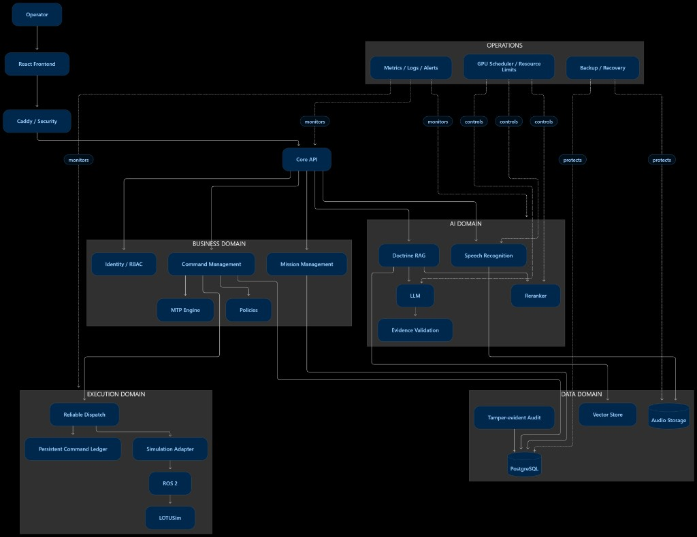
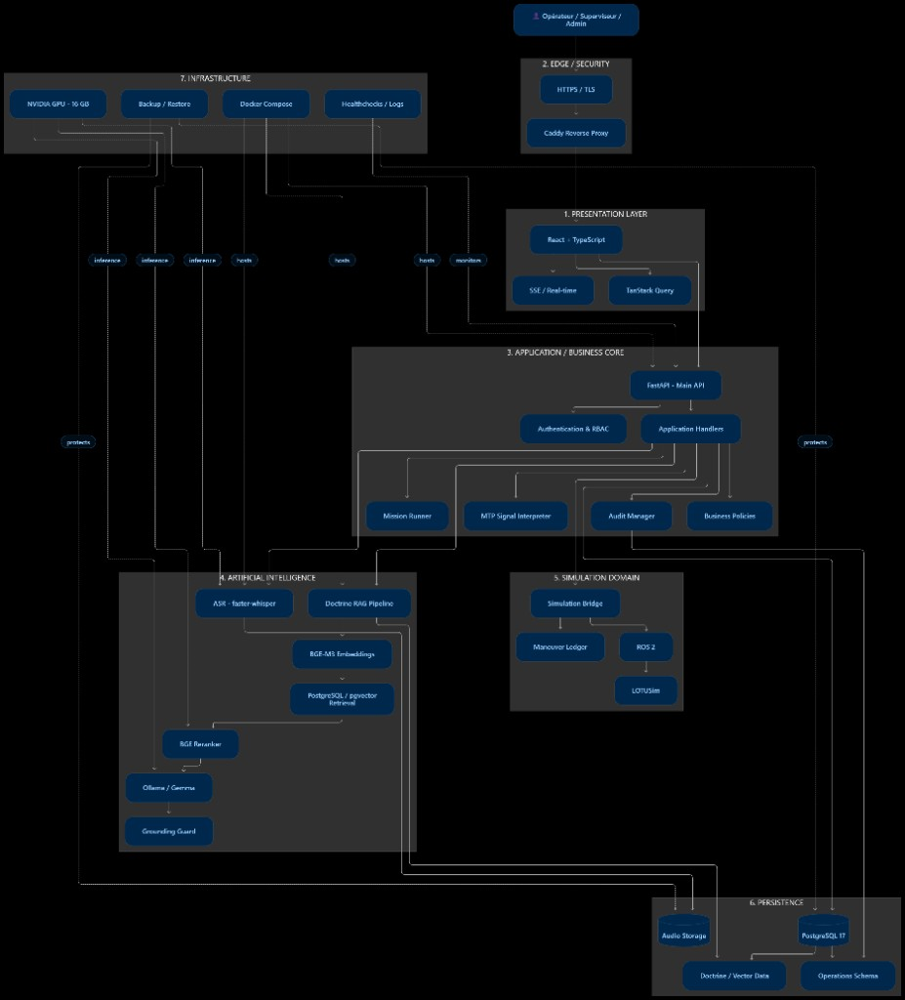
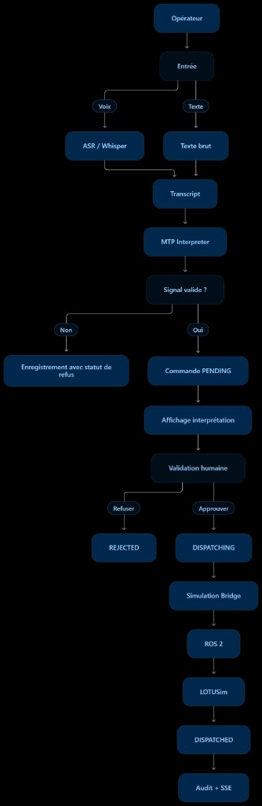
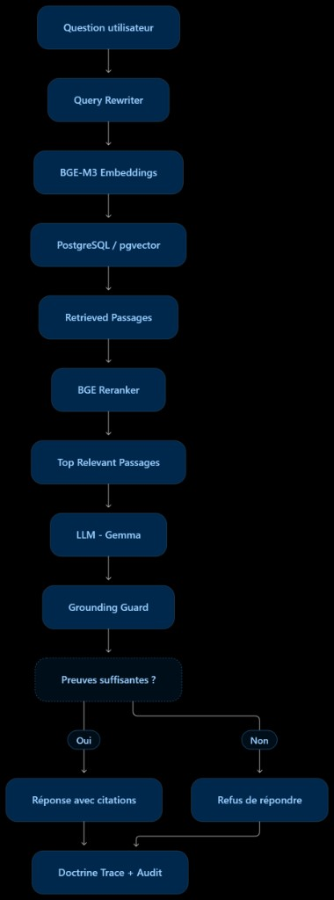

# Hannibal X — architecture du socle · version 1.1.0

Proposition de construction · un serveur on-prem · une carte GPU · pas de cloud.

| Version | Date | Statut |
|---|---|---|
| 1.0.0 | — | référence, `docs/architecture.md`, inchangée |
| 1.1.0 | 16 novembre 2026 | proposition, ce document |

```
MÉTIER CONSERVÉ
  ordre vocal ou tapé ──> la table MTP décide ──> l'opérateur valide ──> LOTUSim exécute
  question doctrine   ──> passages retrouvés  ──> réponse citée, sinon refus
```

## 0. Changements depuis 1.0.0

La 1.1.0 garde la forme (deux applications, quatre services internes), le style hexagonal, la stack et le contrat métier. Elle range les composants en cinq domaines et apporte les évolutions demandées par l’architecture cible.

| Capacité | 1.0.0 | 1.1.0 | Sections |
|---|---|---|---|
| Envoi fiable des ordres | appel direct à `sim-bridge` pendant `DecideCommand`, deux transactions | registre persistant des envois (`ops.command_dispatches`), répartiteur en tâche de fond, reprise après panne, échéance de validité | § 7, § 9, § 21 |
| Registre d’audit infalsifiable | `audit_events` en ajout seul | chaîne de hachage calculée par la base, ancrages quotidiens hors base, vérification nocturne | § 9, § 11, § 23 |
| Métriques, journaux, alertes | journal JSON, minuterie systemd sur `/v1/ready` | Prometheus, Alertmanager, Loki, Grafana ; `/metrics` sur chaque processus | § 3, § 11, § 15, § 24 |
| Ordonnancement GPU et limites | partage de la carte, sémaphore doctrine dans l’API | `GpuGate` dans l’API (priorité à la voix), plafonds VRAM par processus, limites CPU et mémoire par conteneur | § 3, § 7, § 25 |
| Validation des preuves | garde-fou et vérificateur dans `AskDoctrine` | étape nommée `EvidenceValidation`, seuils configurés, motif de refus tracé | § 7, § 17 |
| Magasin vectoriel | « schéma existant » | schéma `v2` nommé, version d’index tracée, lecture seule pour la doctrine | § 9 |

Ce qui ne change pas : un seul worker Uvicorn, pas de bus de messages, pas de Kubernetes, pas de microservices. Le répartiteur et l’ordonnanceur GPU vivent dans le processus `api`, comme le `MissionRunner`.

## 1. Décisions

### Domaines de l’architecture cible



Un domaine est un découpage logique. Il ne crée pas de processus. Correspondance avec le code :

| Domaine | Composants | Où |
|---|---|---|
| Métier | identité et RBAC, gestion des ordres, moteur MTP, politiques, gestion des missions | `apps/api` (application, domain), `packages/core` |
| IA | doctrine RAG, reconnaissance vocale, LLM, reclassement, validation des preuves | `services/doctrine`, `services/asr`, `services/rerank`, `ollama`, `packages/core/grounding` |
| Exécution | envoi fiable, registre persistant des envois, adaptateur de simulation, ROS 2, LOTUSim | `apps/api/application/dispatch`, `ops.command_dispatches`, `services/sim_bridge` |
| Données | audit infalsifiable, magasin vectoriel, stockage audio, PostgreSQL | `postgres` (schémas `ops`, `v2`), volume `hannibal-audio` |
| Opérations | métriques, journaux, alertes ; ordonnanceur GPU et limites ; sauvegarde et restauration | `infra/observability`, `GpuGate` dans `apps/api`, `infra/backup`, `compose.yml` |

### Forme : deux applications, quatre services internes

```
        APPLICATIONS                              SERVICES INTERNES
  ┌──────────────┐    ┌───────────────────┐       ┌────────────┬──────────────────┐
  │ web          │───>│ api               │──────>│ asr        │ GPU, Whisper     │
  │ React        │    │ métier, session,  │       │ doctrine   │ chaîne de modèles│
  │ (via Caddy)  │    │ audit, scénario   │       │ rerank     │ GPU, classement  │
  └──────────────┘    └───────────────────┘       │ sim-bridge │ ROS 2, LOTUSim   │
                                                  └────────────┴──────────────────┘
  Règle : processus séparé = ressource propre (GPU, ROS, modèle résident).
          Le métier reste dans l'api. Pas de microservices.
```

### Style : hexagonal et injecté, dans chaque processus

```
  presentation ──> application ──> domain ──> packages/core (règles MTP)
                        │
                      ports  <── implémentés par ── infrastructure
                        ^                            (SQL, HTTP, modèles, ROS)
                        │
  socle/ ── construit les adaptateurs et les injecte
```

Détail par composant : § 17 et § 22.

### Stack

```
  FRONT     React · TypeScript · Vite · TanStack Query · client OpenAPI · SSE
  API       FastAPI · SQLAlchemy 2 async · httpx · un worker Uvicorn
  IA        faster-whisper · Ollama (gemma4:12b, bge-m3) · bge-reranker
  DONNÉES   PostgreSQL 17 + pgvector · Alembic · pgAdmin
  INFRA     Docker Compose · Caddy · systemd · CI/CD (§ 16)
  OBSERV.   prometheus-client · Prometheus · Alertmanager · Loki · Promtail · Grafana
            dcgm-exporter (GPU) · node-exporter · postgres-exporter
```

### Sécurité

```
  poste ──HTTPS, cookie HttpOnly──> Caddy (seul port publié) ──> api
                                                                  │
      session Argon2id ──> permission à la route ──> politique dans le handler
                                                                  │
  api ──jeton interne──> services, sur réseaux Docker isolés sans sortie

  table MTP, publications : montées depuis le serveur, jamais dans le dépôt ni les images
  audit_events : chaîné par hachage dans la base, ancré chaque jour hors de la base
```

### Erreurs et traces

```
  adaptateur ──> exception typée ──> traducteur unique ──> { code, message, request_id }

  chaque processus ──> journal technique JSON (stdout) ──> Promtail ──> Loki
  chaque processus ──> /metrics ──> Prometheus ──> Alertmanager ──> messagerie du site
  chaque handler   ──> registre métier audit_events (ajout seul, chaîné)
```

Écartés : framework d’orchestration RAG, bus de messages, base d’événements, Kubernetes, ordonnanceur GPU externe (Run:ai, MPS, MIG : la carte 16 Go ne le justifie pas).

## 2. Vue d’ensemble



```
 RÉSEAU DU SITE ┆ SERVEUR ON-PREM
                ┆
 Opérateurs ─443┼──> proxy (Caddy) · TLS · build React
                ┆       │ /v1, SSE
                ┆       v
                ┆      api ───────────── SQL ─────────────────> postgres
                ┆       │  GpuGate                                ^  ops : audit chaîné,
                ┆       ├─ audio ──────> asr (GPU)                │       command_dispatches
                ┆       │                                         │ SQL, lecture (v2)
                ┆       ├─ question ───> doctrine ────────────────┘
                ┆       │                  ├─ prompts ───> ollama (GPU)
                ┆       │                  └─ passages ──> rerank (GPU)
                ┆       │
                ┆       └─ répartiteur ─> sim-bridge ── ROS 2 ──> LOTUSim
                ┆          (lit command_dispatches)
                ┆
                ┆      prometheus ── /metrics ──> tous les processus, GPU, hôte, postgres
                ┆       └─> alertmanager ──> messagerie du site
                ┆      promtail ── journaux Docker ──> loki
                ┆
 Admin ─────SSH─┼──> pgadmin (à la demande) ── SQL ──> postgres
 Exploit. ──SSH─┼──> grafana (127.0.0.1) ──> prometheus, loki
```

- Retours : transcript, réponse citée ou refus, situation des navires, progression de l’envoi par SSE.
- `api` → services : HTTP avec jeton interne. Le navigateur ne voit que `proxy`.
- L’interprétation MTP n’est pas un appel réseau : c’est `packages/core`, dans l’`api`.
- Une manœuvre approuvée n’est plus envoyée par la requête HTTP de l’opérateur. Elle est écrite dans `ops.command_dispatches`, puis envoyée par le répartiteur (§ 7).
- `/metrics` n’est jamais routé par Caddy. Grafana n’est joignable que par tunnel SSH, comme pgAdmin.

## 3. Hébergement on-prem

Une machine Ubuntu avec Docker, une carte NVIDIA 16 Go, LOTUSim déjà installé.

- **Réseaux Docker.** `edge` relie `proxy` et `api`. `app` relie `api`, `asr` et `doctrine`. `models` relie `doctrine`, `ollama` et `rerank`. `data` relie `api`, `doctrine`, `postgres` et `pgadmin`. `obs` relie `prometheus`, `alertmanager`, `loki`, `grafana`, les exportateurs et chaque processus surveillé. `app`, `models`, `data` et `obs` sont `internal` : pas de sortie vers l’extérieur. `sim` relie `api` et `prometheus` à l’hôte, où écoute `sim-bridge` (réseau de l’hôte, pour ROS 2). Les ports sont au § 13, l’ordre de lancement au § 21.
- **Jeton interne.** Chaque service interne exige l’en-tête `X-Internal-Token`. Un conteneur compromis sur un réseau ne commande pas les autres sans ce secret.
- **Socket Docker.** Aucun conteneur ne le monte. Le relais ROS, s’il reste nécessaire, est un service Compose déclaré, pas un conteneur créé par le code.
- **Secrets.** Un fichier par processus dans `/etc/hannibal/` (`api.env`, `asr.env`, …), droits `0600`, hors du dépôt et des images.
- **Données montées.** `/srv/hannibal/kb` (table MTP, lecture seule pour `api`), `/srv/hannibal/eval` (jeux de mesure). Ces fichiers sont tirés d’une publication à diffusion restreinte. `/srv/hannibal/anchors` reçoit les ancrages d’audit écrits par `api` (§ 23).
- **TLS.** Caddy termine le TLS avec le certificat du site, ou sa CA interne déployée sur les postes. Les cookies sont `Secure`.
- **GPU.** `asr`, `rerank` et `ollama` partagent la carte `0`. Budget mesuré : environ 13,6 Go. Chaque processus a un plafond de mémoire GPU, et l’API ordonne les demandes avec `GpuGate`, priorité à la voix (§ 25).
- **Limites de ressources.** Chaque conteneur a `mem_limit`, `cpus` et `pids_limit` (§ 15). Un service qui fuit est tué et redémarré seul, sans emporter l’hôte ni LOTUSim.
- **Sauvegarde.** `pg_dump` nocturne et copie du volume audio vers un disque du site (`infra/backup`, minuteries systemd). Le fichier d’ancrage de l’audit est copié avec la sauvegarde (§ 23). Une restauration est testée chaque mois sur une base jetable, suivie d’une vérification de la chaîne d’audit. Les volumes Docker ne sont pas une sauvegarde.
- **Supervision.** Chaque conteneur redémarre seul (`restart: unless-stopped`) et a un `healthcheck`. Prometheus collecte les métriques, Loki les journaux, Alertmanager prévient l’exploitation par la messagerie du site (§ 24). La minuterie systemd sur `/v1/ready` est gardée comme filet : elle alerte si Prometheus lui-même est tombé.

## 4. Dépôt principal

Un seul dépôt, `hannibal`. Il contient toutes les applications, tous les services et toute la configuration d’exécution.

```
hannibal/
  apps/
    web/                 application React, servie par Caddy
    api/                 application FastAPI, seule session opérateur
  services/
    asr/                 transcription (Whisper, GPU)
    doctrine/            pipeline documentaire
    rerank/              classement des passages (GPU)
    sim_bridge/          pont ROS 2 vers LOTUSim
  packages/
    core/                règles MTP, ordres, cinématique, recommandations, garde-fous
    contracts/           schémas Pydantic des services internes
    platform/            socle technique commun : journal, request_id, jeton interne, traducteur de base
  infra/
    bord/                Caddyfile, Dockerfile (Caddy + build React)
    db/                  Alembic, rôles SQL
    backup/              sauvegarde et restauration (pg_dump, audio), minuteries systemd
    ollama/              modèles attendus
    pgadmin/             servers.json
    observability/       prometheus, règles d'alerte, alertmanager, loki, promtail, tableaux grafana
    compose/             compose.yml, fichiers .env d’exemple
  eval/                  scripts de mesure (les jeux restent sur le serveur)
  .github/workflows/     ci.yml, images.yml, eval.yml, deploy.yml
  pyproject.toml         espace de travail Python (uv)
  docs/architecture.md         version 1.0.0, référence
  docs/architecture-1.1.0.md   ce document
  docs/images/                 schémas de la 1.1.0 (cible, globale, workflows)
```

| Dossier | Nature | Processus Compose |
|---|---|---|
| `apps/web` | application | servie par `proxy` |
| `apps/api` | application | `api` |
| `services/asr` | service interne | `asr` |
| `services/doctrine` | service interne | `doctrine` |
| `services/rerank` | service interne | `rerank` |
| `services/sim_bridge` | service interne | `sim-bridge` |
| `packages/core`, `packages/contracts`, `packages/platform` | bibliothèques | aucun |
| `infra/*` | configuration | `proxy`, `postgres`, `ollama`, `pgadmin`, `migrate` |
| `infra/observability` | configuration | `prometheus`, `alertmanager`, `loki`, `promtail`, `grafana`, `dcgm-exporter`, `node-exporter`, `postgres-exporter` |

Une application a un écran ou une session d’opérateur. Un service interne n’a ni cookie ni page : l’API (ou `doctrine` pour `rerank`) est son seul client. `packages/contracts` est importé des deux côtés de chaque contrat interne : le client de l’API et le serveur du service ne peuvent pas diverger. `packages/platform` évite de recopier cinq fois le journal, le `request_id`, le contrôle du jeton interne et le traducteur d’exceptions. `apps/api` et chaque service ont leur `Dockerfile` dans leur dossier. `apps/web` n’a pas d’image propre : sa build est faite dans l’image `proxy` (`infra/bord/Dockerfile`).

Hors du dépôt : LOTUSim, `/etc/hannibal/*.env`, `/etc/hannibal/audit-anchor.key`, `/etc/hannibal/metrics.token`, `/srv/hannibal/kb`, `/srv/hannibal/eval`, `/srv/hannibal/anchors`, les volumes.

Le détail de chaque dossier est au § 17.

## 5. Couches

Chaque processus Python suit les mêmes couches. Une couche n’importe que les couches en dessous d’elle.

```
presentation     routes FastAPI, schémas d'entrée-sortie, dépendances, traducteur d'exceptions
application      handlers, ports (Protocol), politiques, unité de travail
domain           entités et règles du processus, sans entrée-sortie
infrastructure   adaptateurs : SQLAlchemy, clients HTTP, modèles, ROS, journal
socle            composition : construit les adaptateurs, les injecte, lit la configuration
```

- `domain` n’importe rien d’autre que `packages/core` et la bibliothèque standard.
- `packages/platform` n’est importé que par `presentation`, `infrastructure` et `socle`.
- `application` définit les ports qu’elle consomme. `infrastructure` les implémente.
- `presentation` ne connaît que `application`.
- `socle` est le seul module qui connaît à la fois les ports et les adaptateurs.

Ces règles sont vérifiées en CI par `import-linter`. `mypy` vérifie les types, pas les dépendances entre couches.

## 6. Patrons retenus

| Patron | Où | Raison |
|---|---|---|
| Ports et adaptateurs | `application/ports.py`, `infrastructure/` | Remplacer Whisper, Ollama, Postgres ou ROS par un faux dans les tests. |
| Composition root | `socle/composition.py`, `socle/composition.tsx` | Un seul endroit construit les objets. Aucun handler ne fait `new` d’un adaptateur. |
| Handler applicatif | `application/handlers/` | Une classe, une action. Point unique pour la politique, la transaction et l’audit. |
| Unité de travail | `UnitOfWork`, gestionnaire de contexte | `async with uow:` valide en sortie normale, annule sur exception. La présentation ne gère pas les transactions. |
| Dépôt | agrégats persistés | `User`, `Session`, `Mission`, `Command`, `AuditEvent`, `DoctrineTrace`. Pas de dépôt pour la table MTP ni pour la flotte. |
| Politique | `application/policies.py` | Droits sur une ressource, testés sans HTTP. |
| Couche anti-corruption | `services/sim_bridge` | Les types ROS et LOTUSim ne sortent pas de ce service. L’API parle `Situation` et `Maneuver`. |
| Stratégie | adaptateurs de modèles | Changer `gemma4:12b` ou la taille de Whisper modifie la composition, pas le handler. |
| Pipeline explicite | `AskDoctrine` dans `services/doctrine` | L’ordre (reformuler, chercher, reclasser, rédiger, valider les preuves, sinon refuser) se lit dans une méthode. |
| Machine à états | `Command` dans `apps/api/domain` | Les transitions d’un ordre sont fermées et testées. |
| Clé d’idempotence | identifiant de commande | Une manœuvre renvoyée après une panne n’est pas exécutée deux fois. |
| Boîte d’envoi transactionnelle | `ops.command_dispatches`, `Dispatcher` | La décision et l’intention d’envoi sont écrites dans la même transaction. Un redémarrage reprend les envois en cours. |
| Chaîne de hachage | déclencheur sur `ops.audit_events` | Une ligne modifiée, insérée ou retirée après coup casse la chaîne. Le calcul est dans la base, pas dans l’API. |
| Contrôle d’admission | `GpuGate` dans l’API | Les demandes GPU passent par une file à priorité. La voix ne fait pas la queue derrière une question de doctrine. |
| Tâches de fond, un processus | `MissionRunner`, `Dispatcher`, vérification d’audit, rétention | Dans le processus API, pas de bus de messages. |

Écartés : médiateur générique, chaîne de responsabilité, CQRS avec base de lecture séparée, file de messages pour l’envoi (Redis, RabbitMQ). Ils cachent l’ordre des étapes ou ajoutent un composant à exploiter sans résoudre un problème présent ici : PostgreSQL suffit comme file pour quelques ordres par minute.

## 7. API : handlers et transactions

### Handlers

| Handler | Entrée | Effet | Permission |
|---|---|---|---|
| `Login` | identifiant, mot de passe | crée une session | anonyme |
| `Logout` | cookie | révoque la session | connecté |
| `ReadMe` | cookie | acteur, permissions, publications autorisées | connecté |
| `ListScenarios` | | catalogue YAML | `mission:start` |
| `StartMission` | scénario, navire | monde créé, mission `running` | `mission:start` |
| `StopMission` | mission | monde retiré, mission `finished` | propriétaire ou `mission:read-all` |
| `ReadMission` | mission | dernier état connu, bilan si terminée | propriétaire ou `mission:read-all` |
| `SubmitVoice` | audio | transcript, interprétation, commande `pending` | `command:submit`, propriétaire |
| `SubmitOrder` | texte | interprétation, commande `pending` | `command:submit`, propriétaire |
| `DecideCommand` | approuver, refuser ou réessayer | envoi inscrit dans `command_dispatches` si approuvé ; réponse `202` | `command:decide`, propriétaire |
| `SetHelm` | cap ou vitesse | barre de son navire | `helm:use`, propriétaire |
| `ClassifyContact` | contact, classe | classe enregistrée | `contact:classify`, propriétaire |
| `QueryDoctrine` | question, langue, publication | réponse citée ou refus, trace | `doctrine:ask` |
| `SearchGlossary` | terme | définitions | `glossary:read` |
| `ReadAudit` | filtres | registre paginé | propriétaire ou `audit:read-all` |
| `VerifyAudit` | plage de `seq`, facultative | état de la chaîne, dernier ancrage, première rupture | `audit:verify` |
| `ManageUsers` | créer, désactiver, changer de rôle | comptes | `users:manage` |

Une seule mission peut être `running` : LOTUSim est un seul monde. Un index unique partiel sur `missions(phase) WHERE phase = 'running'` le garantit. Un second `StartMission` reçoit `MissionAlreadyRunning`.

Aucune transaction ne reste ouverte pendant un appel réseau vers un service interne.

### Ordre vocal ou clavier



1. `SubmitVoice` écrit l’audio sur le volume, appelle `asr`, puis interprète le transcript avec `core`.
2. `SubmitOrder` commence directement à l’interprétation.
3. Une transaction enregistre la commande `pending`, son statut de signal et les événements `received`, `transcribed`, `interpreted`, `awaiting_review`.
4. Un signal inconnu, libre, non diffusable ou hors limites est un **résultat**, pas une erreur. La commande est enregistrée avec ce statut. Elle ne peut pas être approuvée.

Un fichier audio sans commande (transaction échouée) est supprimé par la tâche de rétention.

### Décision

```
pending ──refuser──> rejected
pending ──approuver──> dispatching ──accepté par LOTUSim──> dispatched
                           │
                           ├──échec transitoire──> dispatching (nouvelle tentative, attente croissante)
                           └──tentatives épuisées, échéance dépassée, refus définitif──> dispatch_failed
dispatch_failed ──réessayer (avant l'échéance)──> dispatching
```

`DecideCommand` ne parle plus au simulateur. Il écrit une décision ; le répartiteur fait l’envoi.

1. Transaction unique : `SELECT … FOR UPDATE` sur la commande. Contrôle de l’état et du propriétaire. Refus : `rejected`, audit `rejected`, fin. Accord : `dispatching`, `decided_by`, ligne `command_dispatches` (`status = queued`, `deadline_at = decided_at + validité`), audit `approved`. Réponse `202` avec l’état `dispatching`.
2. Le `Dispatcher` prend la ligne, appelle `FleetPort.dispatch(command_id, maneuver)`, et écrit le résultat dans une transaction courte (étapes ci-dessous).
3. L’opérateur voit la suite par l’événement SSE `command` : `dispatched` ou `dispatch_failed` avec son motif.

Réessayer est une décision `retry` sur une commande `dispatch_failed`. Elle remet la même ligne à `queued` et remet à zéro le compteur de tentatives. Elle est refusée par `CommandExpired` si l’échéance de validité est passée : un ordre tactique ancien n’est pas renvoyé, l’opérateur en soumet un nouveau.

### Envoi fiable

Le registre persistant des envois est la table `ops.command_dispatches` (§ 9). Une ligne par commande approuvée. La commande garde l’état métier ; la ligne d’envoi garde l’état technique (tentatives, prochaine échéance, dernière erreur).

```
queued ──pris par le Dispatcher──> in_flight ──accepté──> done
   ^                                   │
   └──── erreur transitoire ───────────┤  attempts < max et now < deadline_at
                                       └──> failed      sinon, ou refus définitif de sim-bridge
```

Le `Dispatcher` est une tâche `asyncio` de l’API, démarrée par le cycle de vie, comme le `MissionRunner`.

1. Réveil sur notification (`asyncio.Event` levé par `DecideCommand` après validation de la transaction) ou toutes les 500 ms.
2. Transaction courte : `SELECT … FROM command_dispatches WHERE status = 'queued' AND next_attempt_at <= now() ORDER BY created_at LIMIT 1 FOR UPDATE SKIP LOCKED`, passage à `in_flight`, `attempts + 1`, `last_attempt_at`. Validation.
3. Hors transaction : `await FleetPort.dispatch(command_id, maneuver)`, délai 5 s. `sim-bridge` ignore un identifiant déjà exécuté et renvoie le même résultat.
4. Transaction courte selon le résultat :
   - accepté : ligne `done`, commande `dispatched`, audit `simulator_dispatched` ;
   - erreur transitoire (délai, `503`, LOTUSim déconnecté) : ligne `queued`, `next_attempt_at = now() + min(0,5 s × 2^attempts, 4 s)`, audit `dispatch_retry` ;
   - refus définitif (manœuvre invalide pour LOTUSim), tentatives épuisées ou échéance dépassée : ligne `failed`, commande `dispatch_failed`, `last_error`, audit `dispatch_failed`.
5. Publication SSE `command` après validation.

Valeurs par défaut, en configuration : 5 tentatives, validité de 30 s après la décision. Les ordres sont envoyés un par un, dans l’ordre des décisions, pour qu’un ordre plus récent ne passe pas devant un plus ancien du même navire.

Au démarrage, les lignes restées `in_flight` sont incertaines : l’API était peut-être tombée entre l’envoi et l’écriture du résultat. `application/startup.py` interroge `GET /maneuvers/{command_id}` sur `sim-bridge` pour chacune. Connue : `done` et `dispatched`. Inconnue : `queued`, le répartiteur la reprend si l’échéance n’est pas passée, sinon `failed`. Un ordre n’est jamais marqué parti sans l’avoir été, ni exécuté deux fois, ni exécuté en retard.

Les manœuvres des navires non joués (`source=scenario`) ne passent pas par ce registre : elles sont recalculées à chaque seconde par le `MissionRunner`, en perdre une est sans effet.

### Barre et contacts

`SetHelm` est la barre manuelle de l’opérateur sur son propre navire. Elle n’est pas un ordre MTP et ne passe pas par la validation. Elle est auditée (`helm`). `ClassifyContact` est audité (`contact_classified`).

### Doctrine

`QueryDoctrine` contrôle la permission et les publications autorisées, demande un jeton `doctrine` à `GpuGate`, appelle `DoctrinePort`, puis écrit `doctrine_traces` et l’audit dans une transaction ouverte après la réponse. `GpuGate` admet une question à la fois et en garde deux en attente au plus 20 s. Au-delà : `DoctrineBusy`. La carte ne sert pas deux rédactions en même temps (§ 25).

Le pipeline suit le flux documentaire cible :



La validation des preuves (`EvidenceValidation`) regroupe trois contrôles, dans cet ordre, et s’arrête au premier échec :

| Contrôle | Règle | Motif de refus |
|---|---|---|
| Couverture | au moins un passage au-dessus du seuil de reclassement | `no_evidence` |
| Ancrage | chaque nombre, nom propre et code cité figure dans un passage cité (`packages/core/grounding`) | `ungrounded_claim` |
| Vérification | le modèle confirme que chaque phrase est soutenue par ses citations | `unsupported_answer` |

Les seuils sont dans la configuration de `doctrine` et dans `doctrine_traces` (`thresholds`), pour qu’une trace se relise avec les seuils qui l’ont produite.

### MissionRunner

Tâche de fond démarrée par le cycle de vie FastAPI. Elle n’existe que dans le processus API, d’où un seul worker Uvicorn.

- Toutes les 300 ms : lit `GET /state` sur `sim-bridge`, garde le dernier état en mémoire, le publie aux abonnés SSE.
- Toutes les secondes : avance le scénario (événements, contacts, objectifs) avec les règles de `core`, calcule les recommandations et les publie.
- Les navires non joués sont pilotés par le runner. Ces manœuvres sont auditées `source=scenario`. Elles ne passent pas par la validation : ce ne sont pas des ordres de l’opérateur.
- La classe d’un contact (`ClassifyContact`) est gardée dans l’état du runner et dans l’audit. Elle n’a pas de table propre.
- En fin de mission, le bilan (objectifs, ordres, délais de décision) est calculé depuis l’audit et renvoyé par `ReadMission`.

### Démarrage et tâches périodiques

`application/startup.py` s’exécute avant l’ouverture des routes : une mission restée `running` passe à `interrupted`, puis les lignes `command_dispatches` restées `in_flight` sont réconciliées avec `sim-bridge`.

`application/retention.py` tourne une fois par jour : sessions expirées, audio orphelin, audio et traces plus vieux que la durée de conservation (§ 20). Il ne touche pas `audit_events` : la purge de l’audit coupe la chaîne et suit sa propre procédure (§ 23).

`application/audit_anchor.py` tourne une fois par jour : écrit un ancrage de la chaîne d’audit et vérifie la chaîne depuis l’ancrage précédent (§ 23).

## 8. Authentification et autorisation

### Session

- `ops.users` : identifiant, hash Argon2id, rôle, date de désactivation.
- `ops.sessions` : hash du jeton, expiration glissante de huit heures, plafond de douze heures, révocation.
- Cookie `HttpOnly`, `Secure`, `SameSite=Strict`. Une seule origine : pas de CORS.
- Les requêtes `POST`, `PUT`, `DELETE` doivent porter un en-tête `Origin` égal au site. Sinon `Forbidden`.
- Cinq échecs de connexion en quinze minutes pour un identifiant et une adresse : `LoginThrottled` jusqu’à la fin de la fenêtre.
- Désactiver un compte révoque ses sessions dans la même transaction.
- Premier compte administrateur : commande `hannibal-api create-admin` sur le serveur. Pas de compte par défaut dans l’image.

### Permissions

La route déclare une permission. `presentation/deps.py` charge l’acteur et la vérifie avant le handler. Le handler applique ensuite la politique sur la ressource (propriétaire de la mission, publication autorisée).

| Permission | operator | supervisor | admin |
|---|---|---|---|
| `mission:start` | oui | oui | oui |
| `mission:read-all` | | oui | oui |
| `command:submit`, `command:decide` | oui, sa mission | oui, sa mission | oui, sa mission |
| `helm:use`, `contact:classify` | oui, sa mission | oui, sa mission | oui, sa mission |
| `doctrine:ask`, `glossary:read` | oui | oui | oui |
| `doctrine:classified` | | oui | oui |
| `audit:read-all` | | oui | oui |
| `audit:verify` | | oui | oui |
| `users:manage` | | | oui |

Personne ne décide un ordre sur la mission d’un autre. Un superviseur observe, il ne commande pas.

La liste des publications classifiées est une configuration du serveur. `ReadMe` renvoie les publications autorisées pour le rôle. Le client peut restreindre sa recherche à l’une d’elles, jamais l’élargir.

## 9. Données

### ORM

Les classes SQLAlchemy vivent dans `infrastructure/persistence/orm.py`. Les entités vivent dans `domain/`. `infrastructure/persistence/mappers.py` convertit les deux. Les handlers ne voient que les dépôts et l’unité de travail.

### Schéma `ops`, géré par Alembic

```text
users             id, username unique, password_hash, role, disabled_at, created_at
sessions          id, user_id, token_hash unique, expires_at, absolute_expires_at, revoked_at
missions          id, scenario_id, player_ship, phase, owner_id, started_at, finished_at
commands          id, mission_id, source, transcript, audio_ref, signal_code, signal_status,
                  maneuver jsonb, state, decided_by, decided_at, dispatched_at
command_dispatches command_id pk fk, status, attempts, next_attempt_at, last_attempt_at,
                  deadline_at, last_error, created_at, updated_at
audit_events      seq bigint pk, at default now(), actor_id, mission_id, command_id, event,
                  payload jsonb, prev_hash bytea, hash bytea
audit_anchors     id, at, seq, hash, signature, exported_to
doctrine_traces   id, at, actor_id, question, language, publication, status, refusal_reason,
                  answer, cited jsonb, model, index_version, thresholds jsonb, duration_ms
```

- `missions.phase` : `running`, `finished`, `interrupted`. Index unique partiel sur `running`.
- `commands.source` : `voice`, `keyboard`, `scenario`. `commands.state` : la machine du § 7.
- `command_dispatches.status` : `queued`, `in_flight`, `done`, `failed`. Index partiel `(next_attempt_at) WHERE status = 'queued'`.
- `audit_events.seq` est attribué par le déclencheur de chaînage, sans trou (§ 23). `hash` est unique.
- `doctrine_traces.refusal_reason` : `no_evidence`, `ungrounded_claim`, `unsupported_answer`, ou vide si la réponse est donnée.
- Index : `commands(mission_id, state)`, `audit_events(mission_id, at)`, `sessions(token_hash)`.
- L’audio est un fichier du volume `hannibal-audio`. La base ne garde que `audio_ref`.
- Le catalogue de scénarios est `apps/api/scenarios/*.yaml`. Il n’est pas en base.

### Magasin vectoriel, schéma `v2`

Il existe déjà et garde son nom pour ne pas réindexer. Alembic ne le gère pas.

```text
passages          id, pub, edition, chapter, section, article, title, page, pdf_page, kind,
                  text, tsv, embedding vector(1024), indexed_at
prows             id, passage_id, pub, row_text, embedding vector(1024)
pquestions        passage_id, embedding vector(1024), …
glossary          en, fr, sense, abbr, def_en, def_fr, source, page, statut
index_versions    version, model, created_at, passages, notes          (nouvelle, 1.1.0)
```

- Seule la commande `reindex` l’écrit. Chaque réindexation ajoute une ligne `index_versions`. `doctrine` lit la dernière et la renvoie dans chaque réponse ; elle est copiée dans `doctrine_traces.index_version`.
- `bge-m3` produit des vecteurs de 1024 dimensions. Changer de modèle d’embeddings impose une réindexation complète et une nouvelle version.

### Rôles SQL

| Rôle | Droits |
|---|---|
| `hannibal_migrator` | DDL sur `ops`. Propriétaire du déclencheur de chaînage. Utilisé par le conteneur `migrate`, jamais par `api`. |
| `hannibal_app` | DML sur `ops`. Sur `audit_events` et `audit_anchors` : `INSERT` et `SELECT` seulement, sans droit sur les colonnes `seq`, `prev_hash`, `hash`. Aucun droit sur `v2`. |
| `hannibal_doctrine` | `SELECT` sur `v2`. Utilisé par le service en marche. |
| `hannibal_indexer` | Écriture sur `v2`. Utilisé seulement par la commande de réindexation. |
| `hannibal_audit_archiver` | `DELETE` sur `audit_events` par segment ancré. Utilisé seulement par la procédure de purge (§ 23). |
| `hannibal_metrics` | `pg_monitor`. Utilisé par `postgres-exporter`. |
| comptes nominatifs | Humains, via pgAdmin. Lecture par défaut. |

### pgAdmin

Profil Compose `admin` : arrêté par défaut, démarré pour une intervention. Port publié sur `127.0.0.1:5050` seulement, joint par tunnel SSH. Comptes nominatifs, lecture par défaut. On n’y corrige pas une commande ou une ligne d’audit : la chaîne de preuve serait rompue, et la vérification nocturne le signalerait (§ 23).

## 10. Exceptions

Les adaptateurs attrapent les erreurs techniques (`httpx`, `asyncpg`, ROS) et lèvent une exception de l’application. Une exception de bibliothèque n’atteint pas la route.

```text
HannibalError
  InvalidCredentials
  Unauthenticated
  Forbidden
  NotFound               MissionNotFound, CommandNotFound, ScenarioNotFound
  Conflict               CommandNotPending, CommandExpired, MissionAlreadyRunning
  Throttled              LoginThrottled, DoctrineBusy
  DependencyUnavailable  SpeechUnavailable, DoctrineUnavailable, SimulatorUnavailable
  DatabaseUnavailable
```

Un statut de signal MTP (inconnu, libre, non diffusable, hors limites) n’est pas une exception. C’est la réponse normale de l’interpréteur, renvoyée en `200`. De même, un échec d’envoi au simulateur n’est plus une exception de `DecideCommand` : c’est l’état `dispatch_failed`, publié par SSE.

Traducteur unique, `presentation/errors.py` :

| Exception | HTTP | `code` |
|---|---|---|
| `InvalidCredentials` | 401 | `invalid_credentials` |
| `Unauthenticated` | 401 | `unauthenticated` |
| `Forbidden` | 403 | `forbidden` |
| `NotFound` | 404 | `not_found` |
| erreur de validation Pydantic | 422 | `invalid_request` |
| `Conflict` | 409 | `command_not_pending`, `command_expired`, `mission_already_running` |
| `Throttled` | 429 | `login_throttled`, `doctrine_busy` |
| `DependencyUnavailable` | 503 | `dependency_unavailable`, avec `dependency` |
| `DatabaseUnavailable` | 503 | `database_unavailable` |
| toute autre | 500 | `internal` |

```json
{ "code": "command_not_pending", "message": "Cette commande n'est plus en attente.", "request_id": "…" }
```

Le message est fixe pour chaque code. Le détail (pile, requête SQL, corps de réponse d’un service) va dans le journal avec `request_id`. Les services internes ont le même traducteur, avec leurs propres codes.

Délais des clients internes : `asr` 60 s, `doctrine` 120 s, `sim-bridge` 5 s, `rerank` 30 s. Un délai dépassé devient `DependencyUnavailable`.

## 11. Journal et registre

### Journal technique

- `structlog`, une ligne JSON par événement, sur stdout, dans tous les processus.
- Champs obligatoires : `ts`, `level`, `service`, `request_id`, `event`. Selon le cas : `actor_id`, `mission_id`, `command_id`, `handler`, `duration_ms`, `status_code`, `dependency`.
- Le middleware de l’API crée `request_id` et le renvoie dans `X-Request-Id`. Les clients internes le transmettent. Chaque service le journalise. Une requête se suit d’un bout à l’autre.
- Rotation par Docker (`json-file`, `max-size`, `max-file`). Promtail lit ces fichiers en lecture seule et les pousse dans Loki (rétention 30 jours). Loki ne remplace pas le registre métier.
- Interdit dans le journal : mot de passe, cookie, jeton interne, audio, texte de publication, prompt complet.
- `info` début et fin de handler ; `warning` refus métier, dépendance lente, nouvelle tentative d’envoi ; `error` exception non prévue, dépendance tombée, chaîne d’audit rompue.

### Métriques

Chaque processus Python expose `GET /metrics` (format Prometheus, `packages/platform/metrics.py`) sur le réseau `obs`, protégé par un jeton de collecte distinct du jeton interne. Pas d’identifiant de mission, d’utilisateur ou de commande en étiquette : la cardinalité reste bornée et les données métier restent dans la base.

| Métrique | Processus | Usage |
|---|---|---|
| `http_requests_total`, `http_request_duration_seconds` (route, code) | tous | trafic, erreurs, latence |
| `dependency_up`, `dependency_duration_seconds` (dépendance) | `api`, `doctrine` | santé des services internes |
| `commands_total` (source, état final), `mission_running` | `api` | ordres traités, mission en cours |
| `command_decision_seconds` | `api` | délai entre `awaiting_review` et la décision |
| `dispatch_queue_depth`, `dispatch_attempts_total` (résultat), `dispatch_latency_seconds` | `api` | envoi fiable |
| `gpu_gate_wait_seconds`, `gpu_gate_rejected_total` (classe) | `api` | ordonnancement GPU |
| `doctrine_answers_total` (statut, motif de refus), `doctrine_stage_seconds` (étape) | `doctrine` | qualité et coût du pipeline |
| `asr_inference_seconds`, `rerank_inference_seconds` | `asr`, `rerank` | inférence |
| `sim_connected`, `sim_state_age_seconds` | `sim-bridge` | lien LOTUSim |
| `audit_chain_verified`, `audit_last_anchor_timestamp` | `api` | intégrité de l’audit |

GPU, hôte et base viennent des exportateurs : `dcgm-exporter` (mémoire, utilisation, température par processus), `node-exporter`, `postgres-exporter`.

### Registre métier

Port `AuditLog`. Insert dans `ops.audit_events`, dans la transaction du handler. La base attribue `seq` et calcule le hachage (§ 23) ; l’API n’écrit que le contenu. Événements : `received`, `transcribed`, `interpreted`, `awaiting_review`, `approved`, `rejected`, `dispatch_retry`, `simulator_dispatched`, `dispatch_failed`, `helm`, `contact_classified`, `doctrine_answered`, `doctrine_refused`, `mission_started`, `mission_finished`, `login`, `login_failed`, `user_changed`, `audit_anchored`, `audit_verified`, `audit_purged`.

`ReadAudit` pagine par mission et par date. La page Registre ne lit que ce handler. `VerifyAudit` renvoie l’état de la chaîne.

## 12. Contrat HTTP public

Préfixe `/v1`. JSON. Cookie de session. Une seule origine.

| Méthode | Chemin | Handler |
|---|---|---|
| POST | `/v1/sessions` | `Login` |
| DELETE | `/v1/sessions/current` | `Logout` |
| GET | `/v1/me` | `ReadMe` |
| GET | `/v1/scenarios` | `ListScenarios` |
| POST | `/v1/missions` | `StartMission` |
| GET | `/v1/missions/{id}` | `ReadMission` |
| DELETE | `/v1/missions/{id}` | `StopMission` |
| GET | `/v1/missions/{id}/events` | flux SSE du `MissionRunner` |
| POST | `/v1/missions/{id}/voice` | `SubmitVoice` (multipart) |
| POST | `/v1/missions/{id}/orders` | `SubmitOrder` |
| POST | `/v1/commands/{id}/decision` | `DecideCommand` (`approve`, `reject`, `retry`) ; `202` si l’envoi est inscrit |
| POST | `/v1/missions/{id}/helm` | `SetHelm` |
| POST | `/v1/missions/{id}/contacts/{cid}/classification` | `ClassifyContact` |
| POST | `/v1/doctrine/questions` | `QueryDoctrine` |
| GET | `/v1/glossary?q=` | `SearchGlossary` |
| GET | `/v1/audit` | `ReadAudit` |
| GET | `/v1/audit/{command_id}/audio` | audio d’une commande, même politique que `ReadAudit` |
| GET | `/v1/audit/integrity` | `VerifyAudit` |
| GET, POST, PATCH | `/v1/users` | `ManageUsers` |
| GET | `/v1/health` | vivant, sans authentification |
| GET | `/v1/ready` | base joignable, état de chaque service interne |

Flux SSE : événements `situation` (navires, contacts, objectifs), `recommendation`, `command` (chaque transition, y compris `dispatching`, `dispatched`, `dispatch_failed` avec motif et nombre de tentatives), `radio`, `phase`, et un battement toutes les 15 s. Caddy ne met pas ce flux en mémoire tampon.

`/metrics` n’existe pas sous `/v1` : il est servi sur le port interne de l’API, réseau `obs`, et Caddy renvoie `404` pour tout chemin hors du site et de `/v1`.

Le schéma OpenAPI est commité. La CI le régénère et échoue en cas d’écart. Le client du front est généré depuis ce fichier.

## 13. Services internes

| Service | Contrat (`packages/contracts`) | Ressource |
|---|---|---|
| `asr` | `POST /transcribe` : audio → transcript, mots, durée | GPU, faster-whisper |
| `doctrine` | `POST /ask` : réponse citée ou refus avec `refusal_reason`, `index_version`, seuils ; `GET /glossary` | Ollama, rerank, pgvector |
| `rerank` | `POST /rerank` : question, passages → scores | GPU, bge-reranker |
| `sim-bridge` | `PUT /world`, `DELETE /world`, `GET /state`, `POST /maneuvers` (idempotent par `command_id`), `GET /maneuvers/{id}`, `POST /helm` | ROS 2, LOTUSim |

Ports internes : `api` 8000, `asr` 8001, `doctrine` 8002, `rerank` 8003, `sim-bridge` 8004, `ollama` 11434, `postgres` 5432. Observabilité : `prometheus` 9090, `alertmanager` 9093, `loki` 3100, `grafana` 3000 (publié sur `127.0.0.1` seulement), `dcgm-exporter` 9400, `node-exporter` 9100, `postgres-exporter` 9187. Aucun n’est publié sur le réseau du site. Seuls 443 (Caddy) et 22 (SSH) sont ouverts. Le pare-feu de l’hôte refuse 8004 hors de `172.21.0.0/24`.

Chaque service expose `GET /health` et `GET /metrics`, et exige `X-Internal-Token` (ou le jeton de collecte pour `/metrics`). Ollama n’expose pas de métriques Prometheus : sa charge se lit côté `doctrine` (`doctrine_stage_seconds`) et côté GPU (`dcgm-exporter`). Aucun n’a de session, de base `ops` ou de règle d’autorisation métier : ces décisions sont prises par l’API avant l’appel.

`sim-bridge` reprend le nœud ROS actuel. Il ne contient pas de scénario : l’horloge et les règles du scénario sont dans le `MissionRunner`.

## 14. Front

### Socle

`apps/web/src/socle/composition.tsx` construit les adaptateurs et les fournit par contexte React.

| Port | Adaptateur | Rôle |
|---|---|---|
| `ApiPort` | `HttpApi` | client généré depuis OpenAPI (`openapi-fetch`) |
| `StreamPort` | `SseStream` | `EventSource` sur la mission active |

Les features passent par `useApi()` et `useStream()`. Elles ne construisent pas d’URL et ne décident jamais si un signal MTP est valide : elles affichent le statut renvoyé par l’API.

### Pages et composants

| Page | Composants |
|---|---|
| Connexion | `LoginForm` |
| Préparation | `ScenarioList`, `ShipPicker`, `FormationPreview`, `StartBar` |
| Console | `MissionBar`, `ObjectiveList`, `Radar`, `ShipTable`, `RadioLog`, `VoiceCapture`, `OrderForm`, `InterpretationCard`, `DecisionBar`, `RecommendationCard`, `Helm`, `ContactCard`, `Debrief` |
| Doctrine | `QuestionForm`, `PublicationSelect`, `Answer`, `CitationList`, `GlossarySearch` |
| Registre | `AuditFilters`, `AuditTable`, `AudioPlayer`, `AuditIntegrityBadge` |
| Vue 3D | `SimView` (enveloppe du rendu three.js actuel), `HelmOverlay` |
| Administration | `UserTable`, `UserForm` |

`DecisionBar` appelle `POST /v1/commands/{id}/decision`. Après `202`, elle affiche « envoi en cours » jusqu’à l’événement SSE `command`. Elle affiche `dispatch_failed` avec son motif et propose de réessayer tant que l’échéance de validité n’est pas passée ; ensuite, elle propose de soumettre un nouvel ordre. `PublicationSelect` liste les publications de `GET /v1/me`. `Answer` affiche le motif d’un refus de la doctrine. La page Registre affiche l’état de la chaîne d’audit (`AuditIntegrityBadge`) pour les rôles qui ont `audit:verify`.

### État

| Donnée | Où |
|---|---|
| Acteur, scénarios, mission, audit, glossaire, utilisateurs | TanStack Query |
| Situation, phase, radio | même cache, écrit par `SseStream` avec `setQueryData` |
| Question doctrine en cours | mutation (`isPending`), bouton bloqué |
| Échelle radar, micro, brouillon | `useState` du composant |

Pas de Redux ni de second store des navires. Les clés de requête sont centralisées dans `socle/query-keys.ts`. Une mutation invalide les clés qu’elle touche. Si le flux SSE tombe, la mission est relue par `GET` toutes les 2 s jusqu’au retour du flux.

### Erreurs

Le client lit `code` et `message`. `401` renvoie à la connexion. `429 doctrine_busy` affiche « assistant occupé ». `503` nomme la dépendance indisponible et propose de réessayer. Une erreur ne vide jamais l’état de la mission.

## 15. Conteneurs

```yaml
# infra/compose/compose.yml — structure
x-common: &common
  restart: unless-stopped
  logging:
    driver: json-file
    options: { max-size: "20m", max-file: "5" }
  pids_limit: 512
  security_opt: ["no-new-privileges:true"]

x-gpu: &gpu
  <<: *common
  deploy:
    resources:
      reservations:
        devices:
          - driver: nvidia
            device_ids: ["0"]
            capabilities: [gpu]

networks:
  edge: {}
  app: { internal: true }
  models: { internal: true }
  data: { internal: true }
  obs: { internal: true }
  sim:                                      # api, prometheus → sim-bridge sur l'hôte
    ipam: { config: [{ subnet: 172.21.0.0/24, gateway: 172.21.0.1 }] }

services:
  proxy:
    <<: *common
    image: hannibal/proxy:${TAG}            # Caddy + build React
    ports: ["443:443"]
    networks: [edge]
    mem_limit: 256m
    cpus: 1
    depends_on: { api: { condition: service_healthy } }
  api:
    <<: *common
    image: hannibal/api:${TAG}
    env_file: /etc/hannibal/api.env
    networks: [edge, app, data, sim, obs]
    extra_hosts: ["sim-bridge:172.21.0.1"]
    volumes:
      - hannibal-audio:/var/lib/hannibal/audio
      - /srv/hannibal/kb:/srv/hannibal/kb:ro
      - /srv/hannibal/anchors:/var/lib/hannibal/anchors          # ancrages d'audit (§ 23)
      - /etc/hannibal/audit-anchor.key:/run/secrets/audit-anchor.key:ro
    mem_limit: 2g
    cpus: 2
    depends_on: { postgres: { condition: service_healthy } }   # asr, doctrine, sim-bridge : souples (§ 21)
    stop_grace_period: 15s
  asr:
    image: hannibal/asr:${TAG}
    <<: *gpu
    env_file: /etc/hannibal/asr.env         # ASR_COMPUTE_TYPE=int8_float16, plafond VRAM (§ 25)
    networks: [app, obs]
    mem_limit: 6g
    cpus: 4
  doctrine:
    <<: *common
    image: hannibal/doctrine:${TAG}
    env_file: /etc/hannibal/doctrine.env
    networks: [app, models, data, obs]
    mem_limit: 2g
    cpus: 2
    depends_on:
      postgres: { condition: service_healthy }
      rerank: { condition: service_healthy }
      ollama: { condition: service_healthy }
  rerank:
    image: hannibal/rerank:${TAG}
    <<: *gpu
    env_file: /etc/hannibal/rerank.env      # RERANK_GPU_MEMORY_FRACTION (§ 25)
    networks: [models, obs]
    mem_limit: 4g
    cpus: 2
  ollama:
    image: ollama/ollama:0.35.1
    <<: *gpu
    environment:
      OLLAMA_NUM_PARALLEL: "1"
      OLLAMA_MAX_LOADED_MODELS: "2"
      OLLAMA_KEEP_ALIVE: "-1"               # modèles résidents, pas de rechargement en mission
      OLLAMA_MAX_QUEUE: "4"
    volumes: ["ollama-data:/root/.ollama"]
    networks: [models]
    mem_limit: 12g
    cpus: 6
  sim-bridge:
    <<: *common
    image: hannibal/sim-bridge:${TAG}
    env_file: /etc/hannibal/sim-bridge.env
    volumes: ["sim-ledger:/var/lib/hannibal/ledger"]
    network_mode: host                      # ROS 2 vers LOTUSim, à valider (§ 20)
    environment: { HTTP_BIND: "172.21.0.1:8004", ROS_AUTOMATIC_DISCOVERY_RANGE: "LOCALHOST" }
    mem_limit: 1g
    cpus: 2
  postgres:
    <<: *common
    image: pgvector/pgvector:pg17
    env_file: /etc/hannibal/postgres.env
    volumes: ["pg-data:/var/lib/postgresql/data"]
    networks: [data]
    mem_limit: 8g
    cpus: 4
    shm_size: 1g
  migrate:
    image: hannibal/api:${TAG}
    command: ["alembic", "upgrade", "head"]
    env_file: /etc/hannibal/migrate.env
    networks: [data]
    depends_on: { postgres: { condition: service_healthy } }
    profiles: [deploy]
  reindex:
    image: hannibal/doctrine:${TAG}
    command: ["hannibal-doctrine", "reindex"]
    env_file: /etc/hannibal/indexer.env
    networks: [models, data]
    profiles: [admin]
  pgadmin:
    image: dpage/pgadmin4
    ports: ["127.0.0.1:5050:80"]
    env_file: /etc/hannibal/pgadmin.env
    networks: [data]
    profiles: [admin]

  # ── opérations : métriques, journaux, alertes (§ 24) ──
  prometheus:
    <<: *common
    image: prom/prometheus:v3.5.0
    command: ["--config.file=/etc/prometheus/prometheus.yml", "--storage.tsdb.retention.time=30d"]
    volumes:
      - ../observability/prometheus:/etc/prometheus:ro
      - /etc/hannibal/metrics.token:/run/secrets/metrics.token:ro
      - prom-data:/prometheus
    networks: [obs, sim]
    mem_limit: 2g
    cpus: 1
  alertmanager:
    <<: *common
    image: prom/alertmanager:v0.28.1
    volumes: ["../observability/alertmanager:/etc/alertmanager:ro"]
    networks: [obs, edge]                   # sortie vers la messagerie du site uniquement (pare-feu)
    mem_limit: 256m
    cpus: 0.5
  loki:
    <<: *common
    image: grafana/loki:3.5.3
    volumes: ["../observability/loki:/etc/loki:ro", "loki-data:/loki"]
    networks: [obs]
    mem_limit: 1g
    cpus: 1
  promtail:
    <<: *common
    image: grafana/promtail:3.5.3
    volumes:
      - ../observability/promtail:/etc/promtail:ro
      - /var/lib/docker/containers:/var/lib/docker/containers:ro   # fichiers json-file, pas le socket
    networks: [obs]
    mem_limit: 256m
    cpus: 0.5
  grafana:
    <<: *common
    image: grafana/grafana-oss:12.1.0
    ports: ["127.0.0.1:3000:3000"]
    env_file: /etc/hannibal/grafana.env
    volumes: ["../observability/grafana:/etc/grafana/provisioning:ro", "grafana-data:/var/lib/grafana"]
    networks: [obs]
    mem_limit: 512m
    cpus: 1
  dcgm-exporter:
    <<: *gpu
    image: nvcr.io/nvidia/k8s/dcgm-exporter:4.2.3-4.1.3-ubuntu22.04
    cap_add: [SYS_ADMIN]
    networks: [obs]
    mem_limit: 256m
  node-exporter:
    <<: *common
    image: prom/node-exporter:v1.9.1
    pid: host
    volumes: ["/:/host:ro,rslave"]
    command: ["--path.rootfs=/host"]
    networks: [obs]
    mem_limit: 128m
  postgres-exporter:
    <<: *common
    image: prometheuscommunity/postgres-exporter:v0.17.1
    env_file: /etc/hannibal/postgres-exporter.env   # rôle hannibal_metrics
    networks: [data, obs]
    mem_limit: 128m

volumes:
  hannibal-audio:
  sim-ledger:
  ollama-data:
  pg-data:
  prom-data:
  loki-data:
  grafana-data:
```

Chaque service a un `healthcheck` sur son `/health`. Les modèles Ollama sont chargés dans `ollama-data` à l’installation : le réseau `models` n’a pas de sortie. Les étiquettes d’images d’observabilité sont figées comme celle d’Ollama ; elles sont importées dans le registre local du site, le serveur n’ayant pas d’accès Internet.

Les limites `mem_limit` et `cpus` sont des valeurs de départ pour une machine de 64 Go et 16 cœurs. Elles sont ajustées après une semaine de mesures Prometheus. La mémoire GPU n’est pas limitable par Compose : elle est plafonnée dans chaque processus (§ 25).

## 16. Qualité, intégration et déploiement

### Tests

| Niveau | Contenu | Où |
|---|---|---|
| Unitaires | `core`, entités, machine à états, politiques, `GpuGate` (priorités, délais) | CI, sans GPU |
| Handlers | ports remplacés par des faux injectés | CI, sans GPU |
| Contrats | schémas de `packages/contracts` contre clients et serveurs | CI |
| Intégration | dépôts SQLAlchemy et migrations sur un Postgres de test | CI, conteneur Postgres |
| Envoi fiable | `Dispatcher` contre un faux `sim-bridge` : panne au milieu de l’envoi, redémarrage, échéance, ordre des envois | CI, conteneur Postgres |
| Audit | chaîne : insertion concurrente, ligne modifiée, ligne supprimée, purge par segment, vérification après restauration | CI, conteneur Postgres |
| Observabilité | `promtool check config` et `promtool test rules` sur les règles d’alerte | CI |
| Front | Vitest, composants avec `ApiPort` factice | CI |
| Mesure | table MTP réelle, jeux de doctrine, latence de la voix pendant une question de doctrine | serveur GPU, la nuit |

La CI utilise une table MTP synthétique. La table réelle et les jeux de doctrine ne quittent pas le serveur.

### Pipeline

| Workflow | Déclencheur | Étapes |
|---|---|---|
| `ci.yml` | chaque demande de fusion | ruff, mypy, import-linter, pytest, écart OpenAPI, `promtool`, lint et tests front, build front |
| `images.yml` | fusion sur `main` | construction des images, étiquette = SHA, envoi au registre local du site |
| `eval.yml` | nuit, ou manuel, runner du serveur | signaux ≥ 93 %, doctrine ≥ 94 %, taux de refus à tort ≤ seuil fixé, voix p95 ≤ 3 s sous charge doctrine ; échec si un score baisse |
| `deploy.yml` | manuel, runner du serveur | `TAG=<sha>`, `compose --profile deploy run migrate`, `compose up -d`, contrôle `/v1/ready`, vérification de la chaîne d’audit, annotation de déploiement dans Grafana |

Retour arrière : redéployer l’étiquette précédente. Les migrations suivent le principe ajout puis retrait sur deux versions, pour qu’une image précédente fonctionne avec le schéma courant.

## 17. Dossiers et socle injecté

Chaque processus a son dossier `socle/`. C’est le seul code qui construit les adaptateurs et les passe aux handlers. Il lit aussi la configuration (`pydantic-settings`, un préfixe par processus). La vue schématique est au § 22.

### `packages/core`

Règles pures, partagées. Pas de socle, pas d’entrée-sortie.

```
packages/core/src/hannibal_core/
  signals/interpreter.py      SignalInterpreter : texte → signal, statut, paramètres
  signals/table.py            chargement de la table MTP depuis un chemin fourni
  orders/grammar.py           ordres tapés (CORPEN, TURN, SPEED, FORM)
  orders/kinematics.py        trajectoires, distance de passage
  orders/recommendations.py   recommandations
  scenario/engine.py          événements, contacts, objectifs, pilotage des navires non joués
  grounding/guard.py          nombres, noms et codes présents dans les extraits
  grounding/evidence.py       règles de couverture et motifs de refus (sans modèle)
```

### `packages/contracts`

```
packages/contracts/src/hannibal_contracts/
  asr.py                      TranscribeResponse
  doctrine.py                 AskRequest, AskResponse, GlossaryEntry
  rerank.py                   RerankRequest, RerankResponse
  sim.py                      WorldSpec, Situation, Maneuver, Helm
```

### `packages/platform`

Socle technique commun aux cinq processus Python. Pas de règle métier.

```
packages/platform/src/hannibal_platform/
  settings.py                 BaseServiceSettings (pydantic-settings)
  logging.py                  configuration structlog, champs obligatoires du § 11
  request_id.py               middleware : lit ou crée X-Request-Id, le met dans le contexte
  internal_auth.py            dépendance FastAPI : contrôle de X-Internal-Token
  internal_client.py          client httpx : jeton, request_id, délai, erreur → DependencyUnavailable
  errors.py                   HannibalError, DependencyUnavailable, traducteur de base
  health.py                   route GET /health
  metrics.py                  route GET /metrics (jeton de collecte), middleware HTTP, métriques communes
```

### `apps/web`

Patron : composition par contexte React. Les hooks `use-*` sont les handlers d’écran.

```
apps/web/src/
  socle/
    ports.ts                  ApiPort, StreamPort
    composition.tsx           providers ; seule construction des adaptateurs
    query-client.ts
    query-keys.ts
  app/router.tsx
  app/guards.tsx              RequireSession, RequirePermission (lit GET /v1/me)
  pages/                      login, prep, console, doctrine, registre, vue3d, admin
  features/
    session/                  use-session.ts, LoginForm.tsx
    mission-setup/            use-scenarios.ts, ScenarioList.tsx, ShipPicker.tsx, FormationPreview.tsx, StartBar.tsx
    mission/                  use-mission.ts, MissionBar.tsx, ObjectiveList.tsx, Debrief.tsx
    radar/                    Radar.tsx, ShipTable.tsx, RadioLog.tsx
    voice/                    use-voice.ts, VoiceCapture.tsx
    orders/                   use-order.ts, use-decision.ts, OrderForm.tsx, InterpretationCard.tsx, DecisionBar.tsx
    recommendations/          use-recommendations.ts (lit le cache écrit par le flux), RecommendationCard.tsx
    helm/                     use-helm.ts, Helm.tsx
    contacts/                 use-contact.ts, ContactCard.tsx
    doctrine/                 use-doctrine.ts, use-glossary.ts, QuestionForm.tsx, PublicationSelect.tsx, Answer.tsx, CitationList.tsx, GlossarySearch.tsx
    audit/                    use-audit.ts, use-audit-integrity.ts, AuditFilters.tsx, AuditTable.tsx, AudioPlayer.tsx, AuditIntegrityBadge.tsx
    vue3d/                    SimView.tsx, HelmOverlay.tsx
    admin/                    use-users.ts, UserTable.tsx, UserForm.tsx
  components/                 Button, Card, DataTable, Dialog — sans port, sans état serveur
  services/
    http-api.ts               HttpApi
    sse-stream.ts             SseStream, repli en lecture toutes les 2 s
    api-error.ts              lecture de code et message, 401 → connexion
    openapi.d.ts              généré
```

| Port | Adaptateur |
|---|---|
| `ApiPort` | `HttpApi` |
| `StreamPort` | `SseStream` |

### `apps/api`

Patron : conteneur `dependency-injector` (`DeclarativeContainer`). Une route dépend d’un handler. Un handler dépend de ports.

```
apps/api/
  Dockerfile
  scenarios/                  catalogue YAML
  src/hannibal_api/
    main.py                   application, cycle de vie, MissionRunner, Dispatcher
    cli.py                    create-admin, verify-audit, purge-audit
    socle/
      settings.py
      composition.py
    presentation/
      middleware.py           request_id, contrôle d'Origin, contexte de journal
      errors.py               traducteur d'exceptions
      deps.py                 acteur, permission
      routes/                 sessions, me, scenarios, missions, commands, doctrine, glossary, audit, users, health
      schemas/
    application/
      ports.py
      policies.py
      handlers/               un fichier par handler du § 7
      mission_runner.py
      dispatch/               dispatcher.py (boucle d'envoi), retry_policy.py (tentatives, attente, échéance)
      gpu_gate.py             GpuGate : file à priorité, jetons, délais (§ 25)
      startup.py              missions interrompues, réconciliation des envois in_flight
      retention.py            purge quotidienne (hors audit)
      audit_anchor.py         ancrage quotidien et vérification de la chaîne
    domain/
      mission.py
      command.py              machine à états
      dispatch.py             CommandDispatch : états queued, in_flight, done, failed
      user.py
      audit.py                AuditEvent, AuditAnchor, résultat de vérification
      errors.py
    infrastructure/
      persistence/            orm.py, mappers.py, repositories.py, unit_of_work.py, dispatch_outbox.py, audit_chain.py
      clients/                asr.py, doctrine.py, sim.py
      audio_store.py
      anchor_export.py        écriture signée du fichier d'ancrage vers le disque de sauvegarde
      scenario_catalog.py
      security/               password.py (Argon2id), session_store.py, throttle.py
      metrics.py              métriques métier (commandes, envoi, GpuGate, audit)
      clock.py
```

Le journal, le `request_id`, le client interne et le point `/metrics` viennent de `packages/platform`.

| Port | Adaptateur |
|---|---|
| `SignalInterpreter` | `hannibal_core.signals`, table lue dans `/srv/hannibal/kb` |
| `SpeechToText` | `AsrClient` |
| `DoctrinePort` | `DoctrineClient` |
| `FleetPort` | `SimClient` |
| `UnitOfWork` et dépôts | SQLAlchemy async |
| `AuditLog` | dépôt `audit_events` (chaînage fait par la base) |
| `AuditChain` | fonctions SQL `ops.verify_audit_chain`, `ops.audit_head` |
| `AnchorExporter` | fichier signé HMAC sur le disque de sauvegarde |
| `DispatchOutbox` | table `ops.command_dispatches` |
| `GpuGate` | file à priorité en mémoire du processus (un seul worker) |
| `Metrics` | `prometheus-client` |
| `AudioStore` | volume `hannibal-audio` |
| `ScenarioCatalog` | fichiers `scenarios/*.yaml` |
| `PasswordHasher` | Argon2id |
| `SessionStore` | table `ops.sessions` |
| `LoginThrottle` | mémoire du processus (remise à zéro au redémarrage, acceptable avec un seul worker) |
| `DependencyProbe` | `/health` de chaque client, pour `/v1/ready` |
| `Clock` | horloge système |

### `services/asr`

Patron : un handler, un moteur.

```
services/asr/src/hannibal_asr/
  main.py
  socle/settings.py, composition.py
  presentation/http.py        POST /transcribe, GET /health, jeton interne
  application/ports.py        SpeechEngine
  application/transcribe.py
  infrastructure/whisper.py
```

| Port | Adaptateur |
|---|---|
| `SpeechEngine` | `WhisperEngine` (faster-whisper, vocabulaire du domaine, `compute_type` et taille du modèle en configuration pour tenir le plafond VRAM) |

### `services/doctrine`

Patron : pipeline explicite, étapes injectées par le constructeur de `AskDoctrine`.

```
services/doctrine/src/hannibal_doctrine/
  main.py
  socle/settings.py, composition.py
  presentation/http.py        POST /ask, GET /glossary, GET /health
  application/ports.py
  cli.py                      reindex (compte hannibal_indexer), lancé à la main par l'exploitation
  application/ask.py          AskDoctrine
  application/evidence.py     EvidenceValidation : couverture, ancrage, vérification, motif de refus
  application/glossary.py
  application/reindex.py      découpe, embeddings, écriture des passages, nouvelle index_version
  infrastructure/
    ollama_chat.py
    ollama_embed.py
    pg_retriever.py
    pg_index_writer.py
    rerank_client.py
```

La réindexation suit les mêmes couches que le service. Elle tourne en commande ponctuelle (service Compose `reindex`, profil `admin`, même image, secrets dans `/etc/hannibal/indexer.env`), pas dans le service en marche. Le service `doctrine` ne détient jamais le mot de passe d’écriture.

| Port | Adaptateur |
|---|---|
| `QueryRewriter`, `Drafter`, `Verifier` | `OllamaChat` |
| `Embedder` | `OllamaEmbed` (`bge-m3`) |
| `Retriever`, `Glossary` | `PgRetriever` |
| `IndexWriter` | `PgIndexWriter` (réindexation seulement) |
| `Reranker` | `RerankClient` |
| `GroundingGuard` | `hannibal_core.grounding` |
| `EvidenceValidation` | compose `GroundingGuard`, `Verifier` et les seuils de configuration |
| `IndexVersion` | `PgRetriever` (table `v2.index_versions`) |

### `services/rerank`

Patron : un handler, un modèle.

```
services/rerank/src/hannibal_rerank/
  main.py
  socle/settings.py, composition.py
  presentation/http.py        POST /rerank, GET /health
  application/ports.py        CrossEncoder
  application/rank.py
  infrastructure/bge.py
```

| Port | Adaptateur |
|---|---|
| `CrossEncoder` | `BgeCrossEncoder` (`torch.cuda.set_per_process_memory_fraction` au chargement, lots bornés) |

### `services/sim_bridge`

Patron : couche anti-corruption. Les handlers parlent `Situation` et `Maneuver`. Les messages ROS restent dans `RosVesselBus`.

```
services/sim_bridge/src/hannibal_sim/
  main.py
  socle/settings.py, composition.py
  presentation/http.py        /world, /state, /maneuvers, /helm, /health
  application/ports.py        VesselBus, ManeuverLedger
  application/world.py
  application/dispatch.py     idempotent par command_id ; état d'un identifiant pour la réconciliation
  application/helm.py         barre manuelle
  application/read_state.py
  infrastructure/ros_bus.py   nœud rclpy
  infrastructure/ledger.py    identifiants déjà exécutés
```

| Port | Adaptateur |
|---|---|
| `VesselBus` | `RosVesselBus` |
| `ManeuverLedger` | fichier sur le volume `sim-ledger` |

### `infra`

Pas de handler. Configuration seulement.

```
infra/bord/Caddyfile          site → build React ; /v1 → api ; SSE sans tampon
infra/bord/Dockerfile         étape Node (build apps/web), étape Caddy
infra/db/alembic.ini, env.py, versions/   dont le déclencheur de chaînage et les fonctions de vérification
infra/db/roles.sql            rôles et droits du § 9, appliqué à l'installation
infra/backup/                 pg-dump.sh, audio-sync.sh, anchor-copy.sh, restore-test.sh (+ verify-audit), unités systemd
infra/ollama/models.txt       gemma4:12b, bge-m3, versions figées
infra/pgadmin/servers.json
infra/observability/
  prometheus/prometheus.yml   cibles : api, asr, doctrine, rerank, sim-bridge, exportateurs
  prometheus/rules/*.yml      règles d'alerte du § 24, avec leurs tests promtool
  alertmanager/alertmanager.yml   routage vers la messagerie du site
  loki/config.yml, promtail/config.yml
  grafana/                    sources de données et tableaux provisionnés (JSON)
infra/compose/compose.yml, *.env.example
```

## 18. Reprise de l’existant

| Existant | Devient |
|---|---|
| `hx/scripts/interpret.py` | `packages/core/signals` |
| `app_v3/mtp.py`, `sim.py`, `reco.py` | `packages/core/orders` |
| boucle de scénario de `app_v3/server.py` | `packages/core/scenario` + `MissionRunner` |
| nœud ROS de `app_v3/server.py` | `services/sim_bridge` |
| `hx/scripts/hx_service.py` (transcription seule) | `services/asr` |
| `v2/scripts/hx2_service_c.py` | `services/doctrine`, `AskDoctrine` |
| `v2/scripts/rerank_service.py` | `services/rerank` |
| `app_v3/scenarios/*.yaml` | `apps/api/scenarios/` |
| `app_v3/web/view3d.js` | `SimView` |
| `audit/audit.jsonl` | `ops.audit_events` (reprise unique, si l’historique est conservé) |

`app`, `app_v2` et `app_v3` sont retirés quand la console React couvre la voix, la décision et le registre.

## 19. Ordre de construction

1. Dépôt, espace de travail uv, `packages/core` extrait, `packages/platform`, tests sur table synthétique, `ci.yml`.
2. `apps/api` : schéma `ops`, Alembic, rôles SQL, `Login`, `ReadMe`, traducteur, journal, `create-admin`.
3. `services/sim_bridge`, `StartMission`, `SubmitOrder`, `DecideCommand`, `MissionRunner`. Front : connexion, préparation, console clavier.
4. `services/asr`, `SubmitVoice`.
5. `services/rerank`, `services/doctrine`, `QueryDoctrine`. Front : doctrine et glossaire.
6. Registre, débrief, vue 3D, administration des comptes.
7. `eval.yml` et `deploy.yml` sur le serveur. Arrêt des trois serveurs `http.server`.

### Passage de 1.0.0 à 1.1.0

Chaque étape est livrable seule et garde le système utilisable. Les étapes 8 à 10 peuvent démarrer dès l’étape 3 de la 1.0.0 ; elles n’attendent pas la fin de la 1.0.0.

8. **Observabilité.** `packages/platform/metrics.py`, `/metrics` sur chaque processus, réseau `obs`, Prometheus, exportateurs, Alertmanager, puis Loki, Promtail et Grafana. Les règles d’alerte du § 24. La minuterie systemd reste en filet.
9. **Limites de ressources et `GpuGate`.** Plafonds VRAM par processus, `mem_limit` et `cpus` mesurés, `GpuGate` à la place du sémaphore doctrine. Mesure de la latence de la voix pendant une question de doctrine, ajoutée à `eval.yml`.
10. **Envoi fiable.** Migration `command_dispatches` (ajout seul). `Dispatcher`, `DecideCommand` en `202`, front sur l’événement SSE `command`. Les commandes `dispatching` de la 1.0.0 sont reprises par la réconciliation de démarrage.
11. **Audit infalsifiable.** Migration en deux temps : ajout de `seq`, `prev_hash`, `hash` et du déclencheur ; chaînage des lignes existantes dans l’ordre de `(at, id)` par une commande unique, avec un premier ancrage « genèse » ; puis `seq` devient la clé. `VerifyAudit`, ancrage quotidien, vérification après restauration.
12. **Validation des preuves.** `EvidenceValidation`, `refusal_reason`, `thresholds`, `v2.index_versions`. Les seuils sont fixés sur les jeux de doctrine avant la mise en service.

## 20. Points ouverts

| Point | À décider avec | Recommandation |
|---|---|---|
| Réseau ROS 2 entre `sim-bridge` et LOTUSim | intégrateur LOTUSim | `network_mode: host` pour `sim-bridge` seul, car LOTUSim tourne sur la même machine et la découverte DDS en conteneur isolé est fragile. Garde-fous : `ROS_DOMAIN_ID` dédié, `ROS_AUTOMATIC_DISCOVERY_RANGE=LOCALHOST`, HTTP de `sim-bridge` lié à l’adresse du pont Docker seulement, jeton interne, pare-feu de l’hôte. À valider par un essai avant l’étape 3 du § 19. |
| Relais `ros_tcp_endpoint` | intégrateur LOTUSim | S’il est une dépendance de LOTUSim, il appartient à l’installation de LOTUSim (unité systemd), pas à notre Compose. `/v1/ready` le signale indisponible via `sim-bridge`. |
| Forge Git et registre d’images | exploitation | Gitea sur le site, avec son registre de conteneurs et un `act_runner` sur le serveur GPU. Gitea Actions lit la syntaxe des workflows du § 16 sans réécriture majeure. |
| Plusieurs opérateurs sur une mission | métier | Un propriétaire en première version, les superviseurs observent. Si le besoin est confirmé : table `mission_members` et politique élargie, sans toucher aux handlers. |
| Conservation | sécurité, juridique | Proposition à faire valider : audio 90 jours, registre et traces doctrine 2 ans, sessions purgées à 30 jours. Les valeurs sont dans la configuration de `retention.py`. |
| Certificat | exploitation | PKI du site si elle existe. Sinon CA interne de Caddy, racine déployée sur les postes par l’exploitation. Dans les deux cas, ACME est désactivé : le serveur n’a pas d’accès Internet. |
| Validité d’un ordre approuvé (1.1.0) | métier | 30 s entre la décision et l’acceptation par LOTUSim, 5 tentatives. Au-delà, l’ordre est `dispatch_failed` et doit être soumis de nouveau. À confirmer selon la doctrine d’emploi. |
| Destination des ancrages d’audit (1.1.0) | sécurité | Fichier signé HMAC copié sur le disque de sauvegarde (autre machine), plus l’empreinte envoyée par la messagerie du site. Mieux encore si disponible : un horodatage par l’autorité du site. La clé HMAC est dans `/etc/hannibal/audit-anchor.key`, hors de la base. |
| Purge de l’audit et conservation (1.1.0) | sécurité, juridique | Purge par segment complet entre deux ancrages, l’ancrage de début du segment conservé devient la nouvelle genèse. Le segment purgé est d’abord exporté et archivé avec son ancrage. |
| Accès à Grafana (1.1.0) | exploitation | Tunnel SSH, comptes nominatifs, lecture par défaut. Pas d’authentification unique en première version. |
| Messagerie des alertes (1.1.0) | exploitation | Récepteur SMTP ou webhook du site pour Alertmanager. Seule sortie réseau autorisée du serveur, ouverte au pare-feu pour `alertmanager` seul. |
| Dimensionnement de l’hôte (1.1.0) | exploitation | Les limites du § 15 supposent 64 Go de RAM et 16 cœurs. À ajuster sur la machine réelle. |

## 21. Ordre de lancement et asynchronisme

### Ordre de lancement

```
déploiement   migrate      attend postgres sain, applique Alembic, s'arrête
                │
étape 1       postgres     sain : pg_isready
                │
étape 2       asr   rerank   ollama        en parallèle, sains quand le modèle est sur le GPU
                │      │        │
étape 3         │   doctrine ◄──┘          attend postgres, rerank, ollama ; préchauffe gemma4 et bge-m3
                │              sim-bridge  aucune attente Compose ; sain quand le nœud ROS tourne
                │
étape 4       api          attend postgres seulement
                │
étape 5       proxy        attend api saine ; le site devient joignable

en parallèle  loki, prometheus, alertmanager, exportateurs, promtail, grafana
              aucune dépendance dure dans un sens ou dans l'autre
```

L’observabilité ne bloque rien et n’est bloquée par rien : un Prometheus tombé n’empêche pas une mission, une API absente apparaît comme une cible en échec et déclenche une alerte.

Deux sortes de dépendances :

| Sorte | Liens | Effet si la cible est absente |
|---|---|---|
| Dure (`depends_on: service_healthy`) | `migrate` → `postgres`, `api` → `postgres`, `doctrine` → `postgres`, `rerank`, `ollama`, `proxy` → `api` | le processus ne démarre pas |
| Souple (vérifiée à l’exécution) | `api` → `asr`, `doctrine`, `sim-bridge` ; `sim-bridge` → LOTUSim | le processus démarre ; `/v1/ready` signale la dépendance ; le handler qui en a besoin renvoie `503` |

L’API ne dépend pas durement des services GPU : un modèle lent à charger ne bloque ni la connexion, ni le registre, ni la préparation. LOTUSim est hors Compose ; il peut démarrer avant ou après `sim-bridge`. Tant qu’il est absent, `GET /state` renvoie `simulator: disconnected` et `StartMission` lève `SimulatorUnavailable`.

### Démarrage interne de l’API

Cycle de vie FastAPI (`lifespan`), dans cet ordre :

1. Configuration et journal.
2. Pool `asyncpg`, un client `httpx.AsyncClient` par service interne.
3. `startup.py` : missions `running` passées à `interrupted` (base seule), puis réconciliation des lignes `command_dispatches` restées `in_flight` avec `sim-bridge`. Si `sim-bridge` ne répond pas, la réconciliation est relancée toutes les 10 s en tâche de fond ; ces lignes ne sont pas reprises par le répartiteur entre-temps, et celles dont l’échéance passe deviennent `failed`.
4. Tâches de fond : `MissionRunner` (inactif sans mission), `Dispatcher`, ancrage et vérification de l’audit (quotidiens), rétention (quotidienne). `GpuGate` est créé vide.
5. Ouverture des routes et de `/metrics`. `/v1/health` passe au vert, `proxy` démarre.

### Arrêt

Compose arrête dans l’ordre inverse : `proxy`, puis `api`, puis les services, `postgres` en dernier. L’API refuse les nouvelles requêtes, ferme les flux SSE, laisse 10 s aux requêtes en cours (`stop_grace_period: 15s`), arrête le `Dispatcher` après l’envoi en cours, passe la mission active à `interrupted`, arrête ses tâches, ferme le pool. Une ligne restée `in_flight` est réconciliée au prochain démarrage.

### Modèle asynchrone

Une boucle d’événements par processus. Toute entrée-sortie est attendue (`await`). Un travail bloquant (inférence GPU, Argon2id, exécuteur ROS) tourne dans un thread, jamais sur la boucle. Il n’y a pas de bus de messages : les seules files sont en mémoire, dans un processus.

| Liaison | Mode | Détail |
|---|---|---|
| navigateur → `api` (actions) | requête-réponse | mutation TanStack, bouton bloqué pendant `isPending` |
| `api` → navigateur | poussée SSE | `MissionRunner` publie dans une `asyncio.Queue` bornée par abonné ; un abonné trop lent est déconnecté et le front relit par `GET` |
| `api` → `asr` | jeton `voice` de `GpuGate`, puis `await`, 60 s | le handler est suspendu, la boucle sert les autres requêtes |
| `api` → `doctrine` | jeton `doctrine` de `GpuGate` (1 actif, 2 en attente, 20 s), puis `await`, 120 s | au-delà : `429 doctrine_busy` |
| `api` → `sim-bridge`, ordre | tâche `Dispatcher`, `await`, 5 s par tentative | la réponse signifie « manœuvre acceptée par LOTUSim », pas « terminée » ; l’exécution se voit dans `situation` |
| `api` → `sim-bridge`, état | lecture périodique, 300 ms | tâche du `MissionRunner` |
| `api` → `postgres` | `await` (`asyncpg`) | transactions courtes, jamais ouvertes pendant un appel réseau |
| `api`, Argon2id et écriture audio | thread (`anyio.to_thread`) | environ 100 ms de calcul pour Argon2id |
| `api`, interprétation MTP | dans la boucle | fonction pure, moins d’une milliseconde |
| `asr`, `rerank` : inférence | thread, une à la fois | les requêtes suivantes attendent leur tour |
| `doctrine` : pipeline | `await` successifs | chaque étape dépend de la précédente |
| `sim-bridge` : ROS | exécuteur `rclpy` dans un thread dédié | `/poses` met à jour un état en mémoire ; l’action ROS est rendue à la boucle par une future |

### Séquences

Ordre vocal :

```
navigateur          api                                asr            postgres
 POST /voice ─────> écrit l'audio (thread)
                    GpuGate : jeton voice (prioritaire)
                    await /transcribe ───────────────> inférence (thread)
                    <──────────────────────────────── transcript
                    interprète (core, dans la boucle)
                    transaction ──────────────────────────────────────> commande pending
 <── 200 commande
 <── SSE command
```

Décision :

```
navigateur          api (handler)       api (Dispatcher)       sim-bridge             LOTUSim
 POST /decision ──> transaction : dispatching
                    + command_dispatches queued
                    + audit approved
                    réveille ─────────> (asyncio.Event)
 <── 202 dispatching
                                        transaction : in_flight
                                        await POST /maneuvers ─> action ROS (thread) ──> but
                                                               <───────────────────── but accepté
                                        <───────────────────── accepté
                                        transaction : done, dispatched, audit
 <── SSE command dispatched
 <── SSE situation, toutes les 300 ms, le navire manœuvre
```

Si `sim-bridge` ne répond pas, le `Dispatcher` réessaie avec une attente croissante jusqu’à l’échéance. L’opérateur voit `dispatching` puis `dispatched`, ou `dispatch_failed` avec le motif.

Question de doctrine :

```
navigateur          api                     doctrine
 POST /questions ─> GpuGate : jeton doctrine (attente ≤ 20 s, sinon 429)
                    await /ask ───────────> reformule (ollama)
                                            embeddings (ollama)
                                            cherche (postgres, v2)
                                            reclasse (rerank)
                                            rédige (ollama)
                                            valide les preuves : couverture,
                                              ancrage (core), vérification (ollama)
                                            sinon refus motivé
                    <──────────────────── réponse citée ou refus, index_version
                    rend le jeton
                    transaction : trace et audit
 <── 200
```

Boucle de mission, deux tâches `asyncio` indépendantes pour qu’un `sim-bridge` lent ne retarde pas le scénario :

```
lecture   toutes les 300 ms   await GET /state ──> sim-bridge (état en mémoire)
                              publie situation aux abonnés SSE
scénario  toutes les 1 s      core.scenario : événements, contacts, objectifs, recommandations
                              navires non joués : await POST /maneuvers
                              publie radio, recommendation, phase
```

## 22. Schéma du socle injecté

Vue schématique du § 17. Elle montre qui construit quoi et qui reçoit quoi, sans implémentation.

### Mécanisme commun à chaque processus

```
                 ┌──────────────────── socle/ ────────────────────┐
                 │ settings     lit /etc/hannibal/<processus>.env  │
                 │ composition  construit chaque adaptateur une    │
                 │              fois, puis les passe aux handlers  │
                 └───────────┬──────────────────────┬─────────────┘
                             │ injecte les ports     │ construit
                             v                       v
 presentation ──appelle──> application ──utilise──> ports <──implémente── infrastructure
 routes, erreurs,          handlers,                (Protocol)            SQLAlchemy, httpx,
 contrôle d'accès          politiques,                                    modèles, ROS
                           unité de travail
                                 │
                                 v
                              domain ──> packages/core
                              règles, sans entrée-sortie
```

Le sens des flèches est celui des imports autorisés. Rien ne remonte : le domaine ignore l’application, l’application ignore l’infrastructure. Seul `socle/` connaît à la fois les ports et les adaptateurs.

### `apps/web`

```
┌─ apps/web ─────────────────────── composition par contexte React ─┐
│ socle/   composition.tsx  ── fournit par contexte ──┐              │
│                                                     v              │
│          ApiPort     ──────────────────>  HttpApi (client OpenAPI) │
│          StreamPort  ──────────────────>  SseStream (EventSource)  │
│                                                                    │
│ app/         routeur, gardes de session et de permission           │
│ pages/       assemblent les features                               │
│ features/    use-*  = handlers d'écran, reçoivent les ports        │
│              composants de la feature                              │
│ components/  briques visuelles, sans port ni état serveur          │
│ services/    adaptateurs HttpApi, SseStream, lecture des erreurs   │
└────────────────────────────────────────────────────────────────────┘
```

### `apps/api`

```
┌─ apps/api ──────────── hexagonal, conteneur dependency-injector ──┐
│ socle/   composition.py  ── injecte dans chaque handler ──┐        │
│                                                           v        │
│   SignalInterpreter  ──>  packages/core + table MTP montée         │
│   SpeechToText       ──>  AsrClient        ──> service asr         │
│   DoctrinePort       ──>  DoctrineClient   ──> service doctrine    │
│   FleetPort          ──>  SimClient        ──> service sim-bridge  │
│   UnitOfWork, dépôts ──>  SQLAlchemy async ──> postgres (ops)      │
│   AuditLog           ──>  table audit_events (chaînée par la base) │
│   AuditChain         ──>  fonctions SQL de vérification            │
│   AnchorExporter     ──>  fichier signé, disque de sauvegarde      │
│   DispatchOutbox     ──>  table command_dispatches                 │
│   GpuGate            ──>  file à priorité en mémoire               │
│   Metrics            ──>  prometheus-client                        │
│   AudioStore         ──>  volume hannibal-audio                    │
│   ScenarioCatalog    ──>  fichiers YAML                            │
│   PasswordHasher     ──>  Argon2id                                 │
│   SessionStore       ──>  table sessions                           │
│   LoginThrottle      ──>  mémoire du processus                     │
│   DependencyProbe    ──>  /health des services                     │
│   Clock              ──>  horloge système                          │
│                                                                    │
│ presentation/    routes, contrôle d'accès, traducteur d'exceptions │
│ application/     handlers, politiques, MissionRunner, Dispatcher,  │
│                  GpuGate, démarrage, rétention, ancrage d'audit    │
│ domain/          Mission, Command (machine à états),               │
│                  CommandDispatch, User, Audit                      │
│ infrastructure/  persistance, clients, sécurité, stockage audio,   │
│                  export d'ancrage, métriques                       │
└────────────────────────────────────────────────────────────────────┘
```

### Services internes

```
┌─ services/asr ─────────────────── un handler, un moteur ──┐
│ socle/  ── injecte ──>  SpeechEngine  ──>  WhisperEngine   │
│ presentation/   route de transcription                     │
│ application/    handler de transcription                   │
│ infrastructure/ moteur Whisper (GPU)                       │
└────────────────────────────────────────────────────────────┘

┌─ services/rerank ─────────────────── un handler, un modèle ┐
│ socle/  ── injecte ──>  CrossEncoder  ──>  BgeCrossEncoder │
│ presentation/   route de classement                        │
│ application/    handler de classement                      │
│ infrastructure/ modèle bge-reranker (GPU)                  │
└────────────────────────────────────────────────────────────┘

┌─ services/doctrine ───── pipeline explicite, étapes injectées ─┐
│ socle/  ── injecte dans AskDoctrine ──┐                         │
│                                       v                         │
│   QueryRewriter      ──>  OllamaChat                            │
│   Drafter, Verifier  ──>  OllamaChat                            │
│   Embedder           ──>  OllamaEmbed (bge-m3)                  │
│   Retriever, Glossary──>  PgRetriever (pgvector)                │
│   Reranker           ──>  RerankClient  ──> service rerank      │
│   GroundingGuard     ──>  packages/core                         │
│   EvidenceValidation ──>  GroundingGuard + Verifier + seuils    │
│   IndexWriter        ──>  PgIndexWriter (réindexation seule)    │
│                                                                 │
│ presentation/   routes question et glossaire                    │
│ application/    AskDoctrine, validation des preuves, glossaire, │
│                 réindexation                                    │
│ infrastructure/ Ollama, pgvector, client rerank                 │
└─────────────────────────────────────────────────────────────────┘

┌─ services/sim_bridge ───────────── couche anti-corruption ROS ─┐
│ socle/  ── injecte ──┐                                          │
│                      v                                          │
│   VesselBus       ──>  RosVesselBus (nœud rclpy) ──> LOTUSim    │
│   ManeuverLedger  ──>  fichier sur le volume sim-ledger         │
│                                                                 │
│ presentation/   routes monde, état, manœuvres, barre            │
│ application/    monde, envoi idempotent, barre, lecture d'état  │
│ infrastructure/ nœud ROS, registre des manœuvres exécutées      │
│                                                                 │
│ Entrée et sortie en Situation et Maneuver ; les types ROS       │
│ restent dans RosVesselBus.                                      │
└─────────────────────────────────────────────────────────────────┘
```

### Bibliothèques partagées

```
            apps/api        services/asr  services/doctrine  services/rerank  services/sim_bridge
               │                 │               │                 │                 │
   ┌───────────┼─────────────────┼───────────────┼─────────────────┼─────────────────┤
   v           v                 v               v                 v                 v
 packages/platform   journal, request_id, jeton interne, client interne, erreurs, santé, métriques
                     importé par presentation, infrastructure et socle

 packages/contracts  schémas des appels internes
                     importé par le client (api, doctrine) et par le service appelé

 packages/core       règles MTP, ordres, scénario, garde-fous ; aucune entrée-sortie
                     importé par le domaine de l'api et par doctrine (garde-fous)
```

Ces règles d’import sont vérifiées en CI par `import-linter`.

## 23. Audit infalsifiable

Objectif : toute modification, suppression ou insertion après coup dans `ops.audit_events` est détectée. La base ne l’empêche pas d’un compte superutilisateur ; elle la rend visible.

### Chaînage dans la base

Un déclencheur `BEFORE INSERT` sur `ops.audit_events`, en `SECURITY DEFINER`, propriété de `hannibal_migrator` :

1. `pg_advisory_xact_lock` sur une clé fixe : les insertions d’audit sont sérialisées jusqu’à la fin de leur transaction.
2. Lit la dernière ligne (`seq`, `hash`).
3. Fixe `NEW.seq = seq + 1`, `NEW.prev_hash = hash`, `NEW.at = now()`.
4. Calcule `NEW.hash = sha256(prev_hash || forme canonique)`. La forme canonique est un `jsonb` construit avec `seq`, `at` en UTC à la microseconde, `actor_id`, `mission_id`, `command_id`, `event`, `payload`, puis converti en texte. PostgreSQL normalise l’ordre des clés d’un `jsonb` : le calcul est reproductible.

Des déclencheurs `BEFORE UPDATE`, `BEFORE DELETE` et `BEFORE TRUNCATE` lèvent une erreur, sauf `DELETE` par `hannibal_audit_archiver` dans la procédure de purge. Le verrou consultatif est tenu jusqu’à la validation : dans chaque handler, l’insert d’audit est la dernière écriture de la transaction, pour que ce verrou soit tenu le moins longtemps possible.

```
seq 41  prev = h40  hash = h41 = sha256(h40 ‖ ligne 41)
seq 42  prev = h41  hash = h42 = sha256(h41 ‖ ligne 42)
seq 43  prev = h42  hash = h43 = sha256(h42 ‖ ligne 43)
          modifier 42 ──> h42 recalculé ≠ prev de 43 ──> rupture à 43
          retirer 42  ──> trou dans seq, prev de 43 ≠ h41 ──> rupture
```

### Ancrages

Une chaîne entière peut être recalculée par qui a les pleins droits sur la base. Les ancrages fixent son état hors de la base.

- Quand : chaque jour à heure fixe et à chaque `mission_finished`.
- Contenu : `seq` et `hash` de tête, date, signature HMAC-SHA256 avec la clé `/etc/hannibal/audit-anchor.key` (lue par l’API, absente de la base et des sauvegardes de la base).
- Où : ligne `ops.audit_anchors`, fichier `/srv/hannibal/anchors/<date>-<seq>.json` monté dans l’API, copié par `infra/backup/anchor-copy.sh` sur le disque de sauvegarde, empreinte envoyée par la messagerie du site. Événement `audit_anchored`.

### Vérification

`ops.verify_audit_chain(from_seq, to_seq)` recalcule les hachages et renvoie la première rupture. Elle est appelée :

- chaque nuit, depuis l’avant-dernier ancrage (`audit_anchor.py`), avec comparaison de la tête aux fichiers d’ancrage hors base ;
- après chaque test de restauration mensuel (`restore-test.sh`) ;
- après chaque déploiement (`deploy.yml`) ;
- à la demande par `VerifyAudit` (`GET /v1/audit/integrity`) et `hannibal-api verify-audit`.

Résultat publié en métrique (`audit_chain_verified`) : une rupture déclenche une alerte critique (§ 24) et un événement `audit_verified` avec le `seq` fautif.

### Purge

La conservation (§ 20) impose de retirer un jour les vieux événements. La purge (`hannibal-api purge-audit`, rôle `hannibal_audit_archiver`) :

1. choisit le dernier ancrage antérieur à la date limite ;
2. exporte les lignes de la genèse courante jusqu’à cet ancrage, avec les deux ancrages, vers l’archive du site ;
3. vérifie le segment exporté ;
4. supprime ces lignes dans une transaction ; l’ancrage choisi devient la genèse ;
5. écrit `audit_purged` (bornes, empreinte de l’export).

### Ce que la chaîne ne fait pas

Elle ne prouve pas qu’un événement était vrai au moment de son écriture : une API compromise peut écrire un faux événement, qui sera correctement chaîné. Elle ne couvre pas les événements écrits depuis le dernier ancrage exporté contre une réécriture complète par un superutilisateur. C’est la raison de l’ancrage en fin de mission.

## 24. Métriques, journaux et alertes

```
 api, asr, doctrine, rerank ─┐ /metrics (réseau obs)
 sim-bridge (172.21.0.1) ────┤ /metrics (réseau sim)
 dcgm, node, postgres ───────┘ exportateurs
              │
              v
         prometheus (30 j) ──règles──> alertmanager ──> messagerie du site
              │
 journaux Docker ──> promtail ──> loki (30 j)
              │                     │
              └──────> grafana <────┘   127.0.0.1, tunnel SSH
```

### Alertes

Fichiers `infra/observability/prometheus/rules/*.yml`, testés par `promtool test rules` en CI.

| Alerte | Condition | Gravité |
|---|---|---|
| `TargetDown` | une cible absente depuis 2 min | critique |
| `ApiNotReady` | `dependency_up == 0` pour une dépendance depuis 2 min | majeure |
| `SimulatorDisconnected` | `sim_connected == 0` et `mission_running == 1` depuis 30 s | critique |
| `DispatchFailing` | au moins un `dispatch_failed` en 5 min | majeure |
| `DispatchQueueStuck` | `dispatch_queue_depth > 0` depuis 1 min | majeure |
| `VoiceSlow` | p95 de `asr_inference_seconds` + `gpu_gate_wait_seconds{class="voice"}` > 3 s sur 10 min | mineure |
| `DoctrineBusyOften` | plus de 10 `doctrine_busy` en 15 min | mineure |
| `DoctrineRefusalSpike` | plus de 50 % de refus sur 1 h, avec au moins 10 questions | mineure |
| `GpuMemoryHigh` | mémoire GPU utilisée > 95 % depuis 5 min | majeure |
| `GpuHot` | température GPU > 85 °C depuis 5 min | majeure |
| `AuditChainBroken` | `audit_chain_verified == 0` | critique |
| `AuditAnchorStale` | dernier ancrage plus vieux que 26 h | majeure |
| `BackupStale` | dernière sauvegarde réussie plus vieille que 26 h (fichier texte lu par `node-exporter`) | majeure |
| `DiskLow` | moins de 15 % libre sur `/var/lib/docker` ou `/srv/hannibal` | majeure |
| `PostgresDown` | `pg_up == 0` | critique |

Les alertes critiques sont envoyées immédiatement, les autres regroupées toutes les 10 minutes. `mission_running` est une jauge de l’API.

### Tableaux Grafana

Provisionnés depuis `infra/observability/grafana`, versionnés dans le dépôt.

| Tableau | Contenu |
|---|---|
| Mission | mission en cours, ordres par état, délai de décision, envoi (file, tentatives, latence), lien LOTUSim |
| IA | latence par étape de doctrine, taux de refus par motif, attente `GpuGate`, inférence ASR et reclassement |
| GPU | mémoire et utilisation par processus, température, puissance |
| Plateforme | requêtes et erreurs par route, conteneurs, CPU, mémoire, disque, Postgres |
| Intégrité | dernière vérification de la chaîne, dernier ancrage, dernière sauvegarde, dernier test de restauration |

Un panneau Loki sur chaque tableau filtre les journaux par `service` et `request_id`.

## 25. Ordonnancement GPU et limites de ressources

La carte `0` sert trois processus résidents : `asr`, `rerank`, `ollama` (gemma et bge-m3). Deux risques : manquer de mémoire GPU (un processus tombe), et ralentir la voix pendant une rédaction longue.

### Plafonds de mémoire GPU

Compose ne limite pas la mémoire d’une carte NVIDIA. Chaque processus a donc un plafond réglé dans sa configuration. Règle : la somme des plafonds reste sous 15 Go, pour garder 1 Go au pilote et aux contextes CUDA.

| Processus | Réglage |
|---|---|
| `asr` | taille du modèle Whisper et `compute_type` (`int8_float16`), un seul flux à la fois |
| `rerank` | `torch.cuda.set_per_process_memory_fraction`, taille de lot maximale |
| `ollama` | `OLLAMA_MAX_LOADED_MODELS=2`, `OLLAMA_NUM_PARALLEL=1`, `OLLAMA_KEEP_ALIVE=-1`, `num_ctx` fixé par `doctrine` |

Les valeurs sont fixées à partir du budget mesuré de 13,6 Go et vérifiées par `dcgm-exporter` pendant `eval.yml`. Tous les modèles restent chargés : pas de chargement à chaud pendant une mission.

### `GpuGate`

Contrôle d’admission dans l’API, avant tout appel qui occupe la carte. L’API est le seul point d’entrée des deux flux GPU (voix vers `asr`, question vers `doctrine`, qui appelle `rerank` et `ollama`). Un seul worker : la file en mémoire suffit.

| Classe | Actifs au plus | En attente au plus | Attente maximale | Au-delà |
|---|---|---|---|---|
| `voice` | 1 | 3 | 10 s | `SpeechUnavailable` |
| `doctrine` | 1 | 2 | 20 s | `DoctrineBusy` |

- Priorité : une question en attente ne démarre pas pendant qu’une transcription est active ou en attente. Une transcription n’attend jamais une question.
- Pas de préemption : une rédaction en cours n’est pas interrompue. La latence de la voix pendant une rédaction est mesurée chaque nuit (`VoiceSlow`, `eval.yml`).
- Le jeton est rendu dans un `finally`, y compris sur délai dépassé ou annulation du client.
- Réindexation : commande d’exploitation hors mission. Elle passe par Ollama sans `GpuGate` ; la procédure impose de la lancer sans mission en cours.

### Limites CPU et mémoire

`mem_limit`, `cpus` et `pids_limit` par conteneur (§ 15). Un dépassement mémoire tue le conteneur fautif, qui redémarre seul ; `TargetDown` prévient l’exploitation. LOTUSim tourne hors Compose : les limites protègent sa part de CPU et de mémoire.
